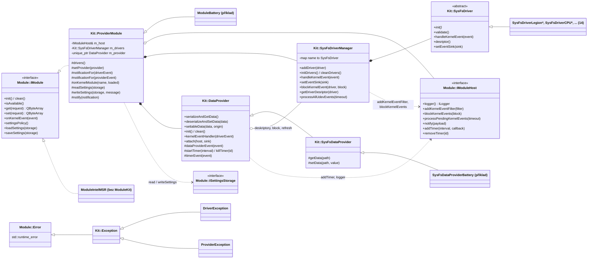
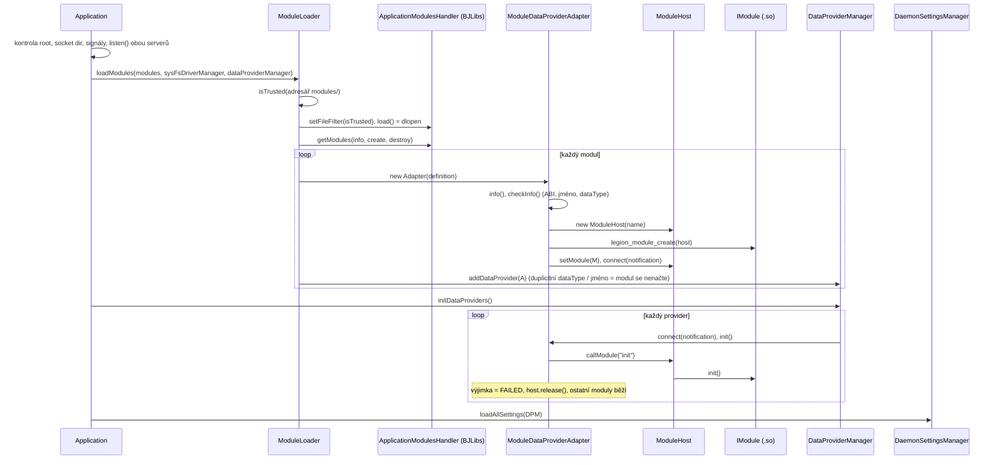
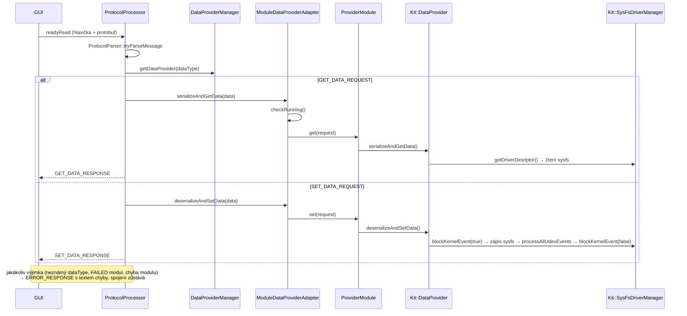
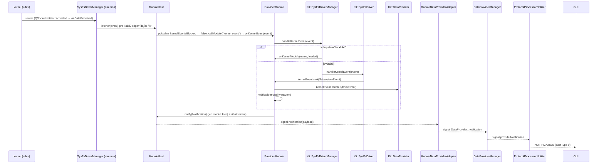
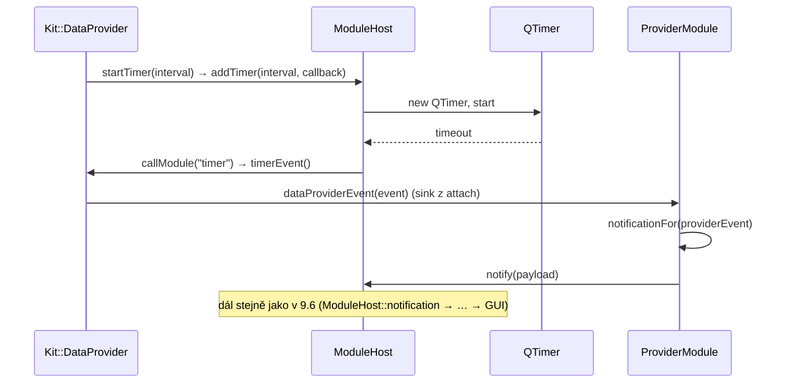
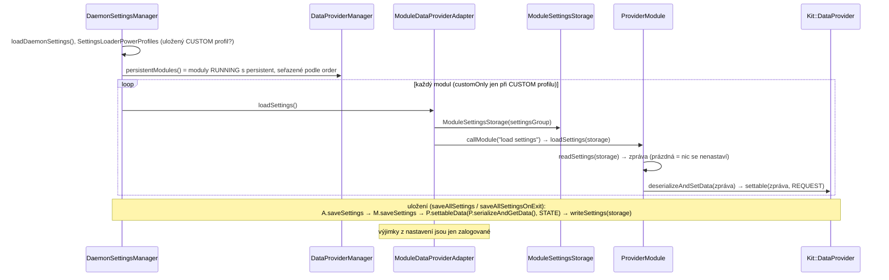

# LenovoLegion-Daemon – framework a moduly

Stav: návrh, v kódu zatím nic nezměněno.

Cíl: z daemona udělat **obecný framework** (protokol, autorizace, načítání modulů, životní cyklus, udev, nastavení, logování, izolace chyb), který nezná žádný konkrétní hardware. Veškerá znalost hardwaru (dnes `SysFsDrivers/`, `SysFsDataProviders/`, `DataProviders/`) bude v **modulech**, které jsou na frameworku i na sobě navzájem co nejvíc nezávislé. Výsledkem má být robustnější systém: chyba jednoho modulu neovlivní ostatní ani spojení s GUI.

---

## 1. Současný stav

**Drivery (16)** dědí z `SysFsDriver`. Provider s nimi komunikuje dvěma způsoby:

- **Za běhu jen přes název:** `SysFsDriverManager::getDriverDesriptor(DRIVER_NAME)` vrátí mapu `název → cesta v sysfs`.
- **Při překladu přes hlavičku driveru:** pomocná struktura (např. `SysFsDriverLegionIntelMSR::IntelMSR`) postavená z té mapy, výčty událostí a `DRIVER_NAME`.

Driver je v podstatě držák cest v sysfs a reakce na udev události. Samostatně nemá smysl, vždy ho používá nějaký provider.

**Providery (17 sysfs a 3 ostatní)** dědí z `DataProvider`:

- rozhraní tvoří `serializeAndGetData`, `deserializeAndSetData`, `init`, `clean` a `kernelEventHandler`,
- identifikuje je `dataType` z centrálního `MessageRegistry.proto`,
- od driver manageru používají jen `getDriverDesriptor`, `getDriverDescriptorsInVector`, `blockKernelEvent`, `refreshDriver` a `processAllUdevEvents`.

**Závislosti providerů na driverech:**

| Provider | Drivery |
|---|---|
| Battery | LegionGameZone, PowerSuplyBattery0 |
| CPUFrequency | CPUXList |
| CPUInfo | CPUInfo |
| CPUOptions | CPUXList |
| CPUPower | LegionOther |
| CPUPState | CPUIntelPState |
| CPUSMT | CPU, CPUXList |
| CPUTopology | CPU, CPUAtom, CPUCore |
| FanCurve | LegionFanMode |
| FanOption | LegionOther |
| GPUPower | LegionOther |
| HWMon | CPUXList, IntelPowercapRapl, LegionHWMon |
| IntelMSR | LegionIntelMSR |
| MachineInformation | LegionMachineInformation |
| Other | LegionEvents, LegionGameZone |
| OtherGpuSwitch | LegionGameZone |
| PowerProfile | LegionGameZone, LegionOther |
| *RGBController* | *LegionEvents (události)* |
| *NvidiaNvml, DaemonSettings* | *žádný driver* |

`SysFsDriverACPIPlatformProfile` se jen registruje v `Application`, žádný provider ani notifier ho nepoužívá. Kandidát na odstranění.

**Framework už teď skoro nezávisí na obsahu zpráv.** `ProtocolProcessor` posílá payload jako neprůhledné bajty a směruje ho jen podle `dataType`. Jediná místa, která znají konkrétní hardware nebo zprávy:

1. **`Application` (konstruktor):** natvrdo registruje 16 driverů a 20 providerů.
2. **`ProtocolProcessorNotifier`:** převádí události 6 konkrétních driverů a 2 providerů na zprávu `Notification`.
3. **`DaemonSettingsManager` a `Settings.h`/`Settings.cpp`:** 27 tříd pro načtení a uložení nastavení, jedna pro každý provider, a pevné pořadí aplikace (nejdřív power profile, některé jen v režimu custom).
4. **Centrální `.proto` v `LenovoLegion-PrepareBuild`:** všechny zprávy, výčet `DataType` a výčet akcí v `Notification`.

**BJLibs už modulový mechanismus má:**

- `ApplicationModulesLoader` načítá `.so` z adresáře `modules/` přes `QLibrary` a funkce `extern "C"` hledá podle názvu,
- makra `APPLICATION_PLUGIN_DEF`/`DEC` deklarují factory funkce,
- `appInitImpl` dostane `ApplicationModulesHandler`, ale daemon ho zatím ignoruje.

---

## 2. Framework a moduly

### 2.1 Rozdělení odpovědnosti

| Framework (daemon) | Modul |
|---|---|
| socket, protokol, autorizace (skupina `legion`) | znalost hardwaru (sysfs, HID, NVML) |
| načtení a ověření modulů (vlastník, práva, ABI) | vlastní `.proto` zprávy |
| životní cyklus, pořadí, závislosti | čtení a zápis hodnot, kontrola rozsahu |
| udev monitor a rozesílání událostí | reakce na události, vlastní notifikace |
| úložiště nastavení (per modul) | obsah a formát vlastního nastavení |
| logger | |
| systémové služby sdílené více moduly (seznam CPU, Legion WMI atributy) | |
| izolace chyb (výjimka → vypnutí modulu, ne pád daemona) | |

Framework nezná žádnou zprávu modulu. Pracuje jen s názvem modulu a neprůhlednými bajty.

### 2.2 Feature moduly místo samostatných driverů

Modul = **jedna funkce** (dnešní provider) **včetně svých driverů**. Driver, který používá jen jeden provider, se stane vnitřním detailem modulu a ven se nedostane. Mezi moduly pak nejsou závislosti při překladu.

Drivery sdílené více providery se stanou **systémovými službami frameworku**. Moduly je používají přes rozhraní SDK, ne přes hlavičky jiných modulů:

| Sdílený driver | Používají | Služba frameworku |
|---|---|---|
| CPUXList | CPUFrequency, CPUOptions, CPUSMT, HWMon | `ICpuList` – seznam CPU a jejich sysfs cesty |
| CPU | CPUSMT, CPUTopology | součást `ICpuList` |
| LegionOther | CPUPower, FanOption, GPUPower, PowerProfile | `ILegionAttributes` – Legion WMI atributy (other) |
| LegionGameZone | Battery, Other, OtherGpuSwitch, PowerProfile | součást `ILegionAttributes` (gamezone) |
| LegionEvents | Other, RGBController | `ILegionEvents` – WMI události firmwaru |

Systémové služby jsou obecné pro Legion notebooky a Linux, ne pro jednu funkci, proto patří do frameworku.

### 2.3 Vlastní zprávy a dynamický `dataType`

- Každý modul má **vlastní `.proto`**. Zprávu zná jen modul a GUI, framework ne.
- `dataType` už není centrální výčet. Modul se identifikuje **názvem** (`"IntelMSR"`) a framework mu při startu přidělí číslo (`quint8`, formát hlavičky zprávy se nemění).
- GUI se při připojení zeptá novým požadavkem `LIST_MODULES` na seznam `{název, dataType, verze}` a dál pracuje s přidělenými čísly.
- Nový modul tak nevyžaduje změnu frameworku ani protokolu.
- Přechodně může framework přidělovat čísla podle dnešního `MessageRegistry.proto`, aby staré GUI fungovalo dál.

### 2.4 Nastavení

- Framework poskytne modulu **vlastní úložiště**: skupinu `[IntelMSR]` v `QSettings`, nebo samostatný soubor `data/modules/IntelMSR.ini`.
- Formát a obsah určuje modul. Z `Settings.cpp`/`Settings.h` se stane 20 malých kusů v modulech.
- Framework si ponechá jen **pořadí aplikace** a podmínku **„jen v custom profilu“** (`SettingsPolicy`).

### 2.5 Notifikace

- `Notification.proto` dnes obsahuje centrální výčet akcí.
- Ve frameworku bude obecná notifikace `{modul, payload}`. Payload je zpráva definovaná modulem. Framework ji jen přepošle a GUI si ji vyloží podle modulu.
- Převod události na notifikaci (dnes v `ProtocolProcessorNotifier`) se přesune do modulu, který událost logicky vlastní.

### 2.6 Izolace chyb a robustnost

Modul v `.so` běží **ve stejném procesu** jako framework:

| Chyba v modulu | `.so` v procesu daemona | Modul jako samostatný proces |
|---|---|---|
| Výjimka | framework ji zachytí, modul vypne, zbytek běží | stejné |
| Segfault, `abort`, nekonečná smyčka | **spadne nebo zamrzne celý daemon** | spadne jen modul, framework ho restartuje |
| Poškození paměti | ovlivní celý daemon | jen modul |
| Únik paměti nebo fd | celý daemon | jen modul |

Pravidla pro moduly v `.so`:

- Framework obalí **každé volání modulu** (`init`, get, set, událost, nastavení) do `try/catch`.
- Výjimka z get/set: framework odpoví klientovi chybou a spojení **neukončí** (dnes `Application::notify()` odpojí GUI).
- Opakované chyby nebo chyba v `init`: framework modul **vypne** (stav `FAILED`), zaloguje to a ostatní moduly běží dál. GUI se o stavu dozví z `LIST_MODULES`.
- Výjimka nesmí projít kódem Qt (signál/slot), to je nedefinované chování. Framework proto volá moduly přímo, ne přes sloty.

Opravdovou izolaci pádů dají jen moduly jako **samostatné procesy**: framework je spouští a komunikuje s nimi přes socketpair stejným protokolem, jaký už existuje. Je to výrazně složitější, ale dává smysl pro rizikové části s cizím kódem:

- **NVML** (proprietární `libnvidia-ml`),
- **RGB/HID** (`hidapi`, komunikace s klávesnicí).

Doporučený kompromis: sysfs moduly jako `.so` s izolací výjimek, NVML a RGB později jako samostatné procesy. API modulu (kap. 4) je navržené tak, aby šlo za stejné rozhraní schovat i modul v jiném procesu.

---

## 3. Architektura

```
LenovoLegion-Daemon                (framework: protokol, autorizace, moduly, udev, nastavení, izolace chyb)
 ├─ libLenovoLegionDaemonSDK.so    rozhraní modulu, IModuleHost, systémové služby (ICpuList,
 │                                 ILegionAttributes, ILegionEvents), SysFsDriver, logger
 ├─ libBJLibs.so                   sdílená (logger, výjimky – viz kap. 6)
 └─ modules/                       root:root 0755, každý .so root:root 0644
     ├─ libModuleIntelMSR.so       + IntelMSR.proto, interní driver LegionIntelMSR
     ├─ libModuleHWMon.so          + HWMon.proto, interní drivery IntelPowercapRapl, LegionHWMon
     ├─ libModuleNvidiaNvml.so     (volitelný, jediný linkuje libnvidia-ml)
     ├─ libModuleRGBController.so  (volitelný, jediný linkuje hidapi)
     └─ ...
```

Zprávy modulů se překládají do knihovny modulu (`libModuleX.so`) a GUI. Žádná zpráva není ve více `.so` zároveň (viz kap. 6, bod 2).

---

## 4. API modulu

### 4.1 Identifikace modulu

```cpp
// LenovoLegionDaemonSDK/ModuleApi.h
namespace LenovoLegionDaemon::Module {

constexpr uint32_t ABI_VERSION = 1;          // zvýšit při každé nekompatibilní změně SDK

struct Info {
    uint32_t            abiVersion;          // musí odpovídat ABI_VERSION frameworku
    const char*         name;                // "IntelMSR" – unikátní identifikace modulu
    const char*         version;             // verze modulu
    const char* const*  requiredServices;    // pole zakončené nullptr, např. {"CpuList", nullptr}
};

}

/* Exportované symboly, hledá je ApplicationModulesLoader */
extern "C" const LenovoLegionDaemon::Module::Info* legion_module_info();
extern "C" LenovoLegionDaemon::IModule*            legion_module_create(LenovoLegionDaemon::IModuleHost& host);
extern "C" void                                    legion_module_destroy(LenovoLegionDaemon::IModule* module);
```

Framework načte `legion_module_info()` dřív, než cokoli vytvoří:

- při jiném `abiVersion` modul odmítne,
- modul se jménem, které už je načtené, odmítne,
- modul, kterému chybí služba z `requiredServices`, nevytvoří (jen zaloguje).

`legion_module_destroy` uvolní modul ve stejné knihovně, ve které vznikl (alokátor a typy z jednoho `.so`).

### 4.2 Rozhraní modulu

```cpp
// LenovoLegionDaemonSDK/IModule.h
class IModule {
public:
    virtual ~IModule() = default;

    /* Lifecycle – výjimka z init → modul FAILED, ostatní běží */
    virtual void init()  = 0;
    virtual void clean() = 0;

    /* Data – payload je zpráva modulu (protobuf), framework ji nezná */
    virtual QByteArray get(const QByteArray& request) = 0;
    virtual QByteArray set(const QByteArray& request) = 0;

    /* Kernel events – udev filtr si modul registruje přes host, framework mu předá jen jeho události */
    virtual void onKernelEvent(const KernelEvent& event) {}

    /* Settings */
    struct SettingsPolicy {
        int  order      = 100;    // pořadí aplikace při startu (PowerProfile = 0)
        bool customOnly = false;  // aplikovat jen při uloženém CUSTOM profilu (FanCurve, CPUPower, GPUPower)
        bool persistent = false;  // modul ukládá nastavení
    };
    virtual SettingsPolicy settingsPolicy() const          { return {}; }
    virtual void loadSettings(ISettingsStorage& storage)   {}   // načti uložené a aplikuj
    virtual void saveSettings(ISettingsStorage& storage)   {}   // přečti stav a ulož
};
```

### 4.3 Rozhraní frameworku pro modul

```cpp
// LenovoLegionDaemonSDK/IModuleHost.h
class IModuleHost {
public:
    virtual ~IModuleHost() = default;

    /* Logging (sdílený logger frameworku, viz kap. 6 bod 1) */
    virtual ILogger& logger() = 0;

    /* Kernel events */
    virtual void addKernelEventFilter(const KernelEvent::Filter& filter) = 0;
    virtual void blockKernelEvents(bool block) = 0;                     // jen události tohoto modulu
    virtual void processPendingKernelEvents(int timeoutInMiliseconds) = 0;

    /* Notification to clients – payload je zpráva modulu */
    virtual void notify(const QByteArray& payload) = 0;

    /* Shared system services */
    virtual ICpuList&          cpuList() = 0;
    virtual ILegionAttributes& legionAttributes() = 0;
    virtual ILegionEvents&     legionEvents() = 0;
};
```

Modul nedostane `SysFsDriverManager`, `DataProviderManager` ani jiný modul. Vidí jen `IModuleHost`.

### 4.4 Načítání ve frameworku

```
appInitImpl(modules):
  1. ověřit modules/ (root:root, bez zápisu pro skupinu a ostatní), stejně jako prepareSocketDir()
  2. modules->load()                                      (ApplicationModulesLoader)
  3. pro každý .so: ověřit vlastníka a práva, legion_module_info() → ABI, jméno, requiredServices
  4. legion_module_create(host) → přidělit dataType → init() v try/catch (chyba → FAILED)
  5. načíst nastavení podle settingsPolicy (order, customOnly), každý modul v try/catch
appStopImpl:
  uložit nastavení → clean() → legion_module_destroy() všech modulů → až potom modules->unload()
```

---

## 5. Mapování souborů na moduly

**Feature moduly (provider + jeho interní drivery):**

| Modul | Z provideru | Interní drivery | Služby frameworku |
|---|---|---|---|
| `Battery` | SysFsDataProviderBattery | PowerSuplyBattery0 | LegionAttributes |
| `CPUFrequency` | SysFsDataProviderCPUFrequency | – | CpuList |
| `CPUInfo` | SysFsDataProviderCPUInfo | CPUInfo | – |
| `CPUOptions` | SysFsDataProviderCPUOptions | – | CpuList |
| `CPUPower` | SysFsDataProviderCPUPower | – | LegionAttributes |
| `CPUPState` | SysFsDataProviderCPUPState | CPUIntelPState | – |
| `CPUSMT` | SysFsDataProviderCPUSMT | – | CpuList |
| `CPUTopology` | SysFsDataProviderCPUTopology | CPUAtom, CPUCore | CpuList |
| `FanCurve` | SysFsDataProviderFanCurve | LegionFanMode | – |
| `FanOption` | SysFsDataProviderFanOption | – | LegionAttributes |
| `GPUPower` | SysFsDataProviderGPUPower | – | LegionAttributes |
| `HWMon` | SysFsDataProviderHWMon | IntelPowercapRapl, LegionHWMon | CpuList |
| `IntelMSR` | SysFsDataProviderIntelMSR | LegionIntelMSR | – |
| `MachineInformation` | SysFsDataProviderMachineInformation | LegionMachineInformation | – |
| `Other` | SysFsDataProviderOther | – | LegionAttributes, LegionEvents |
| `OtherGpuSwitch` | SysFsDataProviderOtherGpuSwitch | – | LegionAttributes |
| `PowerProfile` | SysFsDataProviderPowerProfile | – | LegionAttributes |
| `NvidiaNvml` | DataProviderNvidiaNvml | – | – (volitelný, kandidát na samostatný proces) |
| `RGBController` | DataProviderRGBController + `RGBControlers/` | – | LegionEvents (volitelný, kandidát na samostatný proces) |

**Framework:**

| Soubory | Kam |
|---|---|
| SysFsDriverCPUXList.*, SysFsDriverCPU.* | služba `ICpuList` |
| SysFsDriverLegionOther.*, SysFsDriverLegionGameZone.* | služba `ILegionAttributes` |
| SysFsDriverLegionEvents.* | služba `ILegionEvents` |
| SysFsDriverLegion.h | SDK (společné definice) |
| DataProviderDaemonSettings.* | framework (nastavení samotného daemona) |
| SysFsDriverACPIPlatformProfile.* | nikdo nepoužívá – odstranit |
| Settings.*, DaemonSettingsManager.* | framework jen úložiště a pořadí, obsah do modulů |
| ProtocolProcessorNotifier.* | framework jen přeposílá `{modul, payload}`, převod do modulů |

Volitelné moduly `NvidiaNvml` a `RGBController` umožní přeložit a nainstalovat daemon bez CUDA (dnes povinná závislost `cuda` v `PKGBUILD`) a bez `hidapi`.

---

## 6. Technické pasti

1. **Logger v každém `.so` zvlášť (ověřeno v kódu).** `LoggerHolder` je šablonový singleton se statickou proměnnou a BJLibs se překládá s `--no-gnu-unique`. Každý modul by tak měl **vlastní, neinicializovaný logger** a první `LOG_*` v modulu by vyhodil výjimku „The log file engine was not initialized“.
   → Řešení: logger předávat přes `IModuleHost::logger()`, nebo přeložit BJLibs jako sdílenou knihovnu.

2. **Protobuf zprávy ve více `.so`.** Pokud by se stejný `*.pb.cc` přilinkoval do více knihoven, protobuf by zprávy registroval v globálním poolu vícekrát a při načtení druhé knihovny by skončil fatální chybou („File already exists in database“).
   → Řešení: zpráva modulu je jen v jeho `.so` (a v GUI, což je jiný proces). Sdílené zprávy frameworku (hlavička, `LIST_MODULES`, obecná notifikace) jsou jen v SDK.

3. **Typy výjimek a RTTI přes hranici `.so`.** `DEFINE_EXCEPTION` vytváří typy, které se chytají přes základní třídu `bj::framework::exception::Exception`. Fungovat to bude jen tehdy, když bude základní třída v jedné sdílené knihovně a moduly se přeloží stejným kompilátorem. Framework navíc chytá i `std::exception` a `...`.

4. **Bezpečnost: root daemon načítá `.so`.** Kdo může zapsat do `modules/`, spustí kód jako root.
   - `modules/` a jeho obsah musí patřit `root:root` s právy `0755`/`0644`, **na rozdíl od** `log/` a `data/`, kam může zapisovat skupina `legion`.
   - Framework před načtením zkontroluje vlastníka a práva adresáře i každého `.so`.
   - Do `tmpfiles.d` a `PKGBUILD` to explicitně uvést.

5. **Uvolnění modulů.** Objekty modulu (včetně `QObject`, timerů a spojení signálů) musí zaniknout dřív než `dlclose`. Moduly načíst jednou při startu a uvolnit až po `legion_module_destroy`. `ApplicationModulesLoader::reload()` za běhu nepoužívat.

6. **Výjimky přes Qt.** Výjimka, která projde kódem Qt (signál/slot, `QTimer`), je nedefinované chování. Framework volá metody modulu přímo a každé volání obalí `try/catch`. Moduly s vlastními timery musí výjimky chytat samy (pomůže helper v SDK).

---

## 7. Doporučený postup

Každý krok jde přeložit a otestovat samostatně. Kroky 1–4 zlepší robustnost i bez modulů.

1. **Izolace chyb ve frameworku:** obalit volání providerů do `try/catch`, chybová odpověď místo odpojení klienta (nahrazuje dnešní chování `Application::notify()`).
2. **Systémové služby:** z `CPUXList`/`CPU`, `LegionOther`/`LegionGameZone` a `LegionEvents` udělat rozhraní `ICpuList`, `ILegionAttributes` a `ILegionEvents` a převést na ně providery.
3. **Nastavení do providerů:** `SettingsPolicy`, `loadSettings`/`saveSettings`, framework jen úložiště a pořadí. Odstraní 27 tříd v `Settings.h`.
4. **Notifikace do providerů:** převod událostí z `ProtocolProcessorNotifier` do providerů.
5. **SDK a logger:** `libLenovoLegionDaemonSDK.so` s `IModule`, `IModuleHost` a službami, logger přes host.
6. **Feature moduly:** převést providery i s interními drivery na `.so`, nahradit registraci v `Application` načítáním z `modules/` včetně kontroly vlastníka a práv. Začít volitelnými `NvidiaNvml` a `RGBController`, které přinesou největší užitek (odstranění povinných závislostí).
7. **Vlastní zprávy a dynamický `dataType`:** `.proto` do modulů, `LIST_MODULES` v protokolu, GUI na přidělená čísla.
8. **Volitelně:** `NvidiaNvml` a `RGBController` jako samostatné procesy.

### 7.1 Navržené pořadí prvních kroků (2026-10-22, zatím neschváleno)

API nenavrhovat celé předem, ale hned ho ověřit na pilotním modulu:

1. **HOTOVO (2026-10-22, necommitnuto):** **Izolace chyb** v `ProtocolProcessor::processRequest` (try/catch, chybová odpověď místo odpojení klienta). Odpovídá kroku 1 výše.
   - Nový typ zprávy `MessageHeader::ERROR_RESPONSE = 5`, payload je UTF-8 popis chyby.
   - Daemon: výjimka z provideru i neznámý `dataType` → `LOG_E` + `ERROR_RESPONSE`, spojení zůstává. Chyby parseru (neplatná délka) dál ukončí spojení.
   - GUI: `ProtocolProcessor::get/setDataRequest` vrací `{false, popis}`, `DataProvider::throwRequestError` vyhodí výjimku s kódem `DAEMON_ERROR` a textem od daemona.
   - Ověřeno testem v `/tmp` (skutečný `ProtocolProcessor`, falešný provider): chyba → typ 5 s textem, neznámý `dataType` → typ 5, další požadavek funguje, klient zůstal připojený.
   - Výjimky z timerů a kernel eventů (ToDo bod 7) zatím beze změny.
2. **HOTOVO jako návrh (2026-10-22, necommitnuto, čeká na připomínky):** **API jako hlavičky** v adresáři `LenovoLegion/LenovoLegion-DaemonSDK/`, podprojekt `LenovoLegion-DaemonSDK.pro` (`TEMPLATE = aux`, nic nepřekládá) je v `LenovoLegion.pro` jen kvůli zobrazení v Qt Creatoru. **Hlavičky jsou závazné, kap. 4 je jen původní nástin.**
   - `ModuleTypes.h` – `KernelEvent` (+ `Filter`), `ILogger`, `ISettingsStorage`, typy časovačů.
   - `IModuleHost.h` – rozhraní frameworku pro jeden modul (logger, udev filtry, blokování a zpracování událostí, `notify`, `addTimer`/`removeTimer`) a RAII `KernelEventBlocker` (nahrazuje `blockKernelEvent` + `qScopeGuard` + `processAllUdevEvents(100)`).
   - `IModule.h` – rozhraní modulu (`init`/`clean`/`isAvailable`, `get`/`set`, `onKernelEvent`, `settingsPolicy`/`loadSettings`/`saveSettings`) a pravidla pro výjimky.
   - `ModuleApi.h` – `Info` (ABI verze, název, verze, `legacyDataType`, `settingsGroup`, `requiredServices`), typy a názvy factory funkcí, makro `LEGION_MODULE_DECLARE_ENTRY_POINTS`.
   - Upřesnění oproti kap. 4: časovače přes framework (výjimky z callbacku chytá framework), přechodné `legacyDataType` a `settingsGroup` pro kompatibilitu se současným GUI a `.ini`, načtení/odstranění kernel modulu přes udev filtr na subsystém `module` (žádná zvláštní metoda), `isAvailable()`.
   - Systémové služby (`ICpuList`, …) zatím v API nejsou, přijdou s krokem „systémové služby“.
   - Ověřeno: falešný modul v `/tmp` se přeložil jako `.so` s `-Wall -Wextra -fvisibility=hidden` a exportuje jen `legion_module_info`, `legion_module_create`, `legion_module_destroy`.
3. **HOTOVO (2026-10-23, necommitnuto, čeká na test autora jako root s GUI):** **Pilot `IntelMSR` jako `IModule` uvnitř daemona** (bez `.so`, přes adaptér ve frameworku).
   - Modul: `LenovoLegion/LenovoLegion-DaemonModules/IntelMSR/` (`ModuleIntelMSR.h/.cpp`). Vlastní projekt `IntelMSR.pro` (statická knihovna `libDaemonModuleIntelMSR.a` v `Lib/`), `LenovoLegion-DaemonModules.pro` je `subdirs` se seznamem modulů. Daemon ji linkuje (`LIBS`, `PRE_TARGETDEPS`), `LenovoLegion-Daemon.depends` obsahuje `LenovoLegion-DaemonModules`. `IntelMSR.pro` nastavuje `INCLUDEPATH` znovu (jen modul, SDK, `LenovoLegion-PrepareBuild`), protože `.qmake.conf` přidává BJLibs a `LenovoLegion-Daemon` do všech projektů – překladač tak ohlídá, že modul nepoužívá nic z daemona. Používá jen SDK, Qt Core a zprávy `CpuIntelMSR`, `Notification`, `MessageRegistry`. Třída je skrytá v `.cpp`, ven jen `info()`/`create()`/`destroy()` (+ `create(host, sysfsPath)` pro testy).
   - SDK doplněno: `Module::Error` (`ModuleTypes.h`), `SysFs.h` (`exists`/`read`/`write`, zápis bez bufferu vrací `false` při odmítnutí kernelem), `<chrono>` v `IModuleHost.h`.
   - Framework (`LenovoLegion-Daemon/Modules/`): `ModuleHost` (implementace `IModuleHost`, `QPointer` na `SysFsDriverManager`, `callModule` s try/catch, časovače přes `QTimer`), `ModuleDataProviderAdapter` (modul jako `DataProvider`, stavy CREATED/RUNNING/FAILED, kontrola `Info`), `ModuleSettingsStorage` (`ISettingsStorage` nad stejným `.ini`), `StaticModules` (seznam staticky přilinkovaných modulů).
   - Úpravy: `SysFsDriverManager` – posluchači kernel událostí pro moduly (`addKernelEventListener`/`removeKernelEventListeners`, filtry se obnoví i po `reconnectUdevMonitor`); `DataProvider` – virtuální `loadSettings()`/`saveSettings()` a signál `notification(QByteArray)`; `DataProviderManager` – signál `providerNotification`; `ProtocolProcessorNotifier` – `providerNotificationHandler` (posílá `NOTIFICATION` s payloadem modulu); `Application` – registrace ze `staticModules()` místo `SysFsDriverLegionIntelMSR` a `SysFsDataProviderIntelMSR`; `DaemonSettingsManager::loadIntelMSR`/`saveIntelMSR` volají `loadSettings()`/`saveSettings()` provideru.
   - `SysFsDriverManager.h` includuje SDK relativní cestou (`../LenovoLegion-DaemonSDK/ModuleTypes.h`), protože ho přes hlavičky providerů includuje i GUI.
   - Záměrné rozdíly proti starému chování: (1) při nedostupném zařízení se nastavení **neukládá** (staré ukládání přepsalo uložené offsety nulou), (2) SET při nedostupném zařízení se jen zaloguje (dřív výjimka), (3) chyba zápisu do sysfs se loguje (bod 3 `ToDoList.txt` pro tento modul), ostatní roviny se zapíšou. Zaokrouhlení offsetu na celé mV při ukládání zachováno.
   - Ověřeno testy v `/tmp`: modul s falešným hostem a falešným sysfs (get, set jen přítomných rovin, blokování událostí, chyba zápisu, notifikace `CPU_OFFSET_CHANGED`, uložení s zaokrouhlením, načtení, odstranění/načtení kernel modulu, neplatná zpráva → `Error`) a framework se skutečným udev a reálným sysfs tohoto notebooku (čtení přes adaptér, uložení do `.ini` ve stejném formátu jako dřív).

   **Ke smazání po ověření pilotu (autor si přál zatím ponechat):**
   - `SysFsDrivers/SysFsDriverLegionIntelMSR.h/.cpp`,
   - `SysFsDataProviders/SysFsDataProviderIntelMSR.h/.cpp` (GUI používá `SysFsDataProviderIntelMSR::dataType` ve 4 místech – `OffsetsControl.cpp`, `ToolBarProfilesWidget.cpp` – nahradit `legion::messages::DataType::CPU_INTEL_MSR`),
   - `SettingsLoaderIntelMSR`/`SettingsSaverIntelMSR` v `Settings.h/.cpp`,
   - větev `SysFsDriverLegionIntelMSR::DRIVER_NAME` a include v `ProtocolProcessorNotifier.cpp`,
   - položky v `LenovoLegion-Daemon.pro`.
4. **Úprava API podle pilotu**, pak zbytek postupu.

### 7.2 Dynamické moduly (`.so`) – plán z 2026-10-23

Ověřeno testy: BJLibs `ApplicationModulesLoader` umí načíst `.so` a najít factory funkce (`getModules<...>`). Pokud modul i daemon obsahují stejnou protobuf zprávu, daemon **spadne při `dlopen`** („File already exists in database“) – zprávy musí být ve sdílené knihovně.

1. **HOTOVO (necommitnuto):** sdílená knihovna zpráv `LenovoLegion-Messages/` (`libLenovoLegionMessages.so` v `Installation/`, `plugin` = bez symlinků s verzí). Daemon i GUI ji používají přes `LenovoLegion-Messages.pri` (`LIBS`, `PRE_TARGETDEPS`, `rpath $ORIGIN`), vlastní `*.pb.cc` už nepřekládají. Ověřeno: registrace zpráv (`descriptor_table_*`) je jen v knihovně, v binárkách jen slabé inline metody; GUI startuje.
2. **HOTOVO (necommitnuto):** BJLibs `ApplicationModulesLoader` (zpětně kompatibilní):
   - `setFileFilter(FileFilter)` – `bool(const QFileInfo&, QString& reason)`, volá se před načtením každého souboru, výchozí přijme vše,
   - `errors()` – `{m_file, m_reason}` pro soubory odmítnuté filtrem, chyby `QLibrary::load` (`errorString()`) a knihovny bez symbolů požadovaných v `getModules`,
   - výchozí přípona `defaultSuffix()` = `\.(so|dll)$`, porovnává se s názvem souboru (dřív `".dll|so$"` na celé cestě),
   - jen soubory (`QDir::Files`), adresáře se ignorují, řazení podle jména,
   - `ApplicationModulesHandler`: `setFileFilter`, `errors`, `path`,
   - unit test `test_modulesLoader` v `BJLibs-UnitTests` (kopie systémové `libz`, odmítnutí filtrem, poškozená knihovna, přípony, chybějící symbol).
3. **HOTOVO (necommitnuto):** **Daemon** načítá moduly jen dynamicky, `StaticModules` zrušeno (rozhodnutí autora).
   - `Modules/ModuleLoader` – `loadModules(handler, drivers, providers)` volané v `appInitImpl` po `initDrivers()` a před `initDataProviders()`; `getModules<InfoFn, CreateFn, DestroyFn>` se symboly z `ModuleApi.h`; chyba jednoho modulu (ABI, duplicitní jméno nebo `dataType`, výjimka) se zaloguje a modul se přeskočí; chyby loaderu (`errors()`) se logují; `unload()` se nevolá (knihovny zůstanou načtené do konce procesu).
   - Bezpečnostní filtr `isTrusted`: `lstat` (symlinky se nepřijímají), adresář / běžný soubor, vlastník **root nebo vlastník binárky daemona** (vývojový build patří vývojáři – kdo vlastní binárku, může ji stejně nahradit), bez zápisu pro skupinu a ostatní. Nedůvěryhodný adresář → nenačte se žádný modul.
   - `ModuleDataProviderAdapter::Definition` používá `std::function` (tak je vrací loader), nová metoda `info()`.
   - SDK: makro `LEGION_MODULE_VISIBLE` (viditelnost `default`) na `Error`, `ILogger`, `ISettingsStorage`, `IModuleHost`, `IModule` – typeinfo a vtable přes hranici `.so` i s `-fvisibility=hidden`.
   - Daemon už na `LenovoLegion-DaemonModules` nezávisí (ani při linkování).
4. **HOTOVO (necommitnuto):** **Modul `IntelMSR.pro`:** `TEMPLATE = lib`, `CONFIG += plugin hide_symbols`, `DESTDIR = Installation/modules/`, `rpath $ORIGIN/..`, `-Wl,--no-undefined -Wl,--as-needed`, linkuje `libLenovoLegionMessages.so`. Exportované vstupní body `legion_module_info/create/destroy` (`LEGION_MODULE_DECLARE_ENTRY_POINTS`) v `ModuleIntelMSR.cpp`. Ověřeno: export jen 3 symbolů, žádná registrace zpráv v modulu, kód modulu v daemonu není.
5. **HOTOVO (necommitnuto):** **Balíček:** `PKGBUILD` – `modules/` 0755, `*.so` 0644, `tmpfiles.d` – `d /opt/<pkg>/modules 0755 root root -`.

Ověřeno end-to-end testem v `/tmp` (skutečný `ModuleLoader` + BJLibs loader + `.so` modulu): adresář zapisovatelný skupinou → nic se nenačte; modul zapisovatelný skupinou → odmítnut s důvodem v logu; správná práva → modul načten a čte reálné sysfs přes `DataProviderManager`.

Poznámka: když modul chybí (nenainstalovaný nebo odmítnutý), GUI dostane na jeho `dataType` `ERROR_RESPONSE` „Data provider not found“ a zobrazí chybu. Pro volitelné moduly (NVML, RGB) bude potřeba, aby GUI chybějící modul zvládlo (např. přes `LIST_MODULES`).

Vedlejší nález: když daemon nemůže otevřít log, `main.cpp` skončí s kódem 0 (systemd ho nerestartuje), stejné jako bod 6 v `ToDoList.txt`.

### 7.3 Převod všech providerů na moduly (2026-10-24, necommitnuto, čeká na test autora jako root s GUI)

Rozhodnutí autora: sdílené drivery jako zdrojový kód bez sdílení za běhu (varianta A), notifikace vlastní ten modul, který atribut zapisuje, nastavení „jen v custom profilu“ přechodně řeší `DaemonSettingsManager`. Starý kód zůstává (nepoužívaný), smaže se po ověření (seznam níže a v `ToDoList.txt`).

**`LenovoLegion-DaemonModules/ModuleKit/`** (statická knihovna `libDaemonModuleKit.a`, přilinkovaná do každého modulu, za běhu nic sdíleného):
- `SysFsDriver`, `SysFsDriverManager`, `DataProvider`, `SysFsDataProvider` – stejné rozhraní jako v daemonu (kód providerů a driverů se převádí mechanicky), bez `QObject` a BJLibs, napojené na `IModuleHost`: `emit kernelEvent/dataProviderEvent` jsou obyčejné metody, `startTimer/killTimer/timerEvent` přes časovače hostitele, `LOG_*` přes logger hostitele (`KitLog.h`), `THROW_EXCEPTION`/`DEFINE_EXCEPTION`/`errcodeInfo`/`descriptionInfo` v `KitException.h` (výjimky odvozené z `Module::Error`).
- `SysFsDriverManager` (kit): jeden udev filtr na subsystém se sjednocenými vlastnostmi (starý `SysFsDriverManager` předával `EVENT_TYPE` driverům na `wmi` podle pořadí v mapě), filtr `module` – při načtení kernel modulu se drivery znovu inicializují, chyba driveru se zaloguje a driver vyčistí.
- `SysFsDataProvider::setData` (kit): zápis bez bufferu, nepovedené otevření vyhodí výjimku (jako dřív), chyba zápisu se zaloguje (bod 3 `ToDoList.txt`).
- `ProviderModule` – obecný `IModule` nad providerem a jeho drivery: háčky `notificationFor` (události driverů i provideru), `onKernelModule`, `readSettings`/`writeSettings` (převod zprávy na klíče), helpery `notification`, `eventType`, `arrayKey`/`arraySizeKey` (pole ve formátu `QSettings`), `serialize`/`parse`.
- `ModuleEntry.h` – makro `LEGION_KIT_MODULE(třída, jméno, verze, dataType, skupina nastavení)` pro vstupní body.
- `ModuleKit.pri` – společné nastavení `.pro` modulu (`plugin`, `hide_symbols`, `INCLUDEPATH` jen kit/SDK/zprávy, `libLenovoLegionMessages.so`, `rpath $ORIGIN/..`, `--no-undefined`, `--as-needed`).
- `Drivers/` – 14 driverů přenesených z daemona (bez IntelMSR a nepoužívaného ACPIPlatformProfile), filtry `wmi` mají vlastnosti `EVENT_TYPE`/`EVENT_VALUE`.

**Moduly (18 nových + IntelMSR, každý `Installation/modules/libDaemonModule<Jméno>.so`):**

| Modul | Drivery | Notifikace | Nastavení (skupina, pořadí) |
|---|---|---|---|
| MachineInformation | LegionMachineInformation | `LENOVO_DRIVER_ADDED/REMOVED` (kernel modul `lenovo_legion`) | – |
| CPUInfo | CPUInfo | – | – |
| Battery | LegionGameZone, PowerSuplyBattery0 | `POWER_SUPPLY_BATTERY0_CHANGE` | – |
| HWMon | CPUXList, IntelPowercapRapl, LegionHWMon | – | – |
| PowerProfile | LegionGameZone, LegionOther, LegionEvents | `THERMAL_MODE_CHANGE` | PowerProfileData, 0 |
| CPUOptions | CPUXList | `CPU_X_LIST_RELOADED` | CPUsControlData, 10 |
| CPUFrequency | CPUXList | `CPU_FREQUENCY_CHANGED` (časovač) | CPUFrequencyData, 20 |
| FanCurve | LegionFanMode | `FAN_CURVE_CHANGED` (LegionFanMode) | FanCurveData, 30, custom |
| CPUPower | LegionOther | `POWER_CONTROL_CHANGED` (CPU_*, APU_PPT, GPU_TAC) | CPUPowerData, 40, custom |
| GPUPower | LegionOther | `POWER_CONTROL_CHANGED` (GPU_PB, GPU_TGP, GPU_TMP) | GPUPowerData, 50, custom |
| FanOption | LegionOther | `FAN_CURVE_CHANGED` (FF_S) | FanOptionData, 60 |
| CPUSMT | CPU, CPUXList | – | CPUSMTData, 70 |
| NvidiaNvml | – (linkuje `libnvidia-ml`) | – | NvidiaNvmlData, 80 |
| IntelMSR | vlastní | `CPU_OFFSET_CHANGED` | IntelMSRData, 90 |
| Other | LegionEvents, LegionGameZone | `KEYLOCK_STATUS_CHANGE` | OtherData, 100 |
| CPUPState | CPUIntelPState | `CPU_PSTATE_CHANGED` (časovač) | CPUPStateData, 110 |
| CPUTopology | CPU, CPUAtom, CPUCore | – | – |
| OtherGpuSwitch | LegionGameZone | – | – |
| RGBController | LegionEvents (linkuje `hidapi`, obsahuje `RGBControlers/`) | `SPECIAL_KEY_PRESSED` | – |

Odchylky od původní tabulky (podle pravidla „notifikaci posílá ten, kdo atribut zapisuje“): `FF_S` vlastní FanOption (zapisuje `fan_full_speed`), `CPU_X_LIST_RELOADED` vlastní CPUOptions (zapisuje online stav CPU; změna SMT z CPUSMT se notifikuje také – GUI jen obnoví ovládání CPU ještě jednou), `GPU_TAC` vlastní CPUPower (zapisuje `gpu_total_onac`).

**Framework:** `Application` registruje jen `DataProviderDaemonSettings`, vše ostatní jsou moduly. `DaemonSettingsManager::loadAllSettings/saveAllSettings` procházejí moduly podle `settingsPolicy().order` (`persistentModules`), moduly s `customOnly` se načtou jen při uloženém CUSTOM profilu (zjištění profilu zůstává staré). `ModuleDataProviderAdapter::settingsPolicy()`.

**Ověřeno** srovnávacím programem (`/tmp/legion-tools/compare`, staré providery proti modulům na tomto notebooku, jen čtení): všechny moduly kromě RGB vracejí stejná data, rozdíly jen v hodnotách, které se mezi čteními mění (energie, aktuální frekvence, PCIe propustnost). RGB nejde porovnat bez roota (`/dev/hidraw*` jen pro roota) – ověřeno jen načtení a inicializace. Uložené nastavení (`saveAllSettings` přes moduly proti starým funkcím `save*`) je stejné ve všech skupinách včetně polí. Načtení nastavení netestováno (zapisuje do hardwaru).

**SMAZÁNO 2026-10-27 (necommitnuto)** – staré implementace podle seznamu níže:
- daemon: `SysFsDrivers/`, `SysFsDataProviders/`, `RGBControlers/`, `SysFsDriver.*`, `SysFsDataProvider.*`, `RGBController.*`, `RGBControllerDetector.h`, `StringUtils.*`, `DataProviders/DataProviderNvidiaNvml.*`, `DataProviders/DataProviderRGBController.*`,
- `SysFsDriverManager` je jen udev monitor pro moduly (posluchači, `processAllUdevEvents`, obnova monitoru), podpora starých driverů a signály `kernelEvent`/`moduleSubsystem` odstraněny; `DataProvider::kernelEventHandler` a `DataProviderManager::kernelEventHandler` odstraněny, `DataProviderManager(QObject*)`,
- `ProtocolProcessorNotifier(DataProviderManager*, QLocalSocket*, QObject*)` jen přeposílá notifikace modulů,
- `DaemonSettingsManager` bez funkcí `load*/save*` pro jednotlivé providery, `Settings.h/.cpp` jen `Settings`, `SettingsLoaderPowerProfiles` (zjištění CUSTOM profilu) a `SettingsLoader/SaverDaemonSettings`,
- `LenovoLegion-Daemon.pro` bez `hidapi`, CUDA a `libnvidia-ml` – daemon závisí jen na `libLenovoLegionMessages.so` a `libudev` (binárka ~12 MB místo ~43 MB),
- GUI používá `legion::messages::DataType::*` místo `LenovoLegionDaemon::*::dataType`.

Zůstává v `LenovoLegion-Daemon`: `RGBControllerInterface.h` a `RGBControllerKeyNames.h` – datový model RGB sdílený s GUI (modul RGBController má vlastní kopii v `Kit`). Kandidát na přesun do společného místa (např. vedle zpráv).

Ověřeno: celý build bez chyb a varování, všech 19 modulů se načte a vrací data (test s novými objekty daemona), GUI startuje.

**Původní seznam ke smazání:**
- `LenovoLegion-Daemon/SysFsDrivers/*`, `SysFsDataProviders/*`, `DataProviders/DataProviderNvidiaNvml.*`, `DataProviders/DataProviderRGBController.*`, `RGBController.*`, `RGBControlers/*`, `RGBController*.h`, `StringUtils.*`, `SysFsDataProvider.*`, `SysFsDriver.*` (pokud ho nepotřebuje `SysFsDriverManager` – ten zůstává kvůli udev),
- per-provider funkce `DaemonSettingsManager::load*/save*` a třídy `SettingsLoader*/SettingsSaver*` v `Settings.h/.cpp` (kromě `PowerProfiles` – používá se pro zjištění CUSTOM profilu – a `DaemonSettings`),
- převody událostí v `ProtocolProcessorNotifier` (`kernelEventHandler`, `dataProviderEventHandler`, `moduleSubsystemHandler`), zůstane jen `providerNotificationHandler`,
- položky v `LenovoLegion-Daemon.pro`, závislosti daemona na `cuda`/`libnvidia-ml` a `hidapi` (pak má jen modul NvidiaNvml a RGBController),
- GUI: `LenovoLegionDaemon::SysFsDataProvider*::dataType` a `DataProvider*::dataType` nahradit `legion::messages::DataType::*`.

---

## 8. Kontext pro navázání konverzace

Tahle kapitola slouží k navázání práce v nové konverzaci (Claude Code). Popisuje stav k **2026-10-22**.

### 8.1 Co už je hotové (commity v `main`)

| Commit | Obsah |
|---|---|
| `a6fcb6c` | daemon: `deleteLater` pro protocol processory, async-signal-safe `bj::framework::Signal` (self-pipe + `QSocketNotifier`), výjimka při selhání `listen()`, `Restart=on-failure` v service |
| `0544c42` | `log/`, `data/` jako `root:legion 2770` přes `tmpfiles.d`, logger s `O_NOFOLLOW`, `umask(0007)` v daemonu i GUI |
| `ca26196` | kernel: chyby zápisu MSR offsetu se vracejí ze `store`; protokol: limit délky zprávy 1 MiB, neblokující `tryParseMessage` v daemonu |
| `e3fdacc` | udev pravidlo RAPL: `root:legion 0440` (dřív `0444`, `energy_uj` byl čitelný pro všechny – CVE-2020-8694) |
| `3c22730` | `processAllUdevEvents` se společným timeoutem, `reconnectUdevMonitor` bez pádu (retry po 5 s) |
| `9aa933d` | RGB: kontrola rozsahu profilu/jasu, timeout čekání v reálném čase; NVML: kontrola rozsahu offsetů, inicializace min/max; GUI: pořadí ukončení; výjimka z `init` driveru při načtení modulu; CPU frequency: polling jen `scaling_min/max`, oprava indexu v `init()` |
| `ddd1667` | GUI: přepínače power profilu po SETu znovu načtou stav; úprava `ToDoList.txt` |

Zbývající známé problémy jsou v `LenovoLegion/ToDoList.txt`.

### 8.2 Rozhodnutí a preference autora

- **Neplatný požadavek od klienta:** daemon ho **jen zaloguje (`LOG_E`) a ignoruje**, nevyhazuje výjimku (výjimka dnes odpojí GUI přes `Application::notify()`). GUI si po SETu hodnotu znovu načte a ukáže skutečný stav.
- **Chyby zápisu do sysfs:** stačí je logovat, bez změny protokolu (bod 3 v `ToDoList.txt`).
- **Blokování vlastních kernel eventů** během SETu (`blockKernelEvent` + `processAllUdevEvents(100)`) zůstává, autor ho nechce měnit.
- **Práva:** `log/`, `data/` zapisovatelné pro skupinu `legion`, ostatní nic. `modules/` bude jen pro roota.
- **`bj::framework::Signal`** zůstává v BJLibs, používá se i v jiných projektech.
- **Commit message anglicky**, styl repozitáře (rozkazovací způsob v předmětu, odrážky v těle). Commity dělá autor sám, Claude jen navrhne zprávu.
- **`ToDoList.txt` anglicky.** Komunikace s autorem česky.
- Před větší změnou nejdřív návrh, implementace až po souhlasu.

### 8.3 Prostředí

- Repozitář: `/home/bojar/Git-projects/lenovo-legion-linux-toolkit`, větev `main`.
- Qt 6.12 (`/home/bojar/Qt/6.12.0/gcc_64`), Qt Creator, build adresář `LenovoLegion/build/Desktop_Qt_6_12_0_Debug`.
- Překlad: `make -j24` v build adresáři (nebo `build` přes Qt Creator MCP). Kernel modul jde přeložit v kopii v `/tmp` (`make -C <kopie> all`), hlavičky běžícího jádra jsou k dispozici.
- Daemon i GUI za běhu Claude netestuje (daemon potřebuje roota, GUI běžící daemon). Ověřuje se překladem a malými testy v `/tmp`.

### 8.4 Otevřené otázky k modulům

- Schválit pořadí v kap. 7.1 (izolace chyb → hlavičky API → pilot `IntelMSR`).
- Logger v modulech: přes `IModuleHost::logger()`, nebo BJLibs jako sdílená knihovna?
- Přechod na dynamický `dataType` (`LIST_MODULES`) hned, nebo až po převodu všech modulů (přechodně čísla podle `MessageRegistry.proto`)?
- Odstranit nepoužívaný `SysFsDriverACPIPlatformProfile`?

## 9. Diagramy tříd a komunikace

Stav po převodu všech modulů a smazání starého kódu (2026-10-29). Diagramy jsou v Mermaid (Qt Creator / GitHub je zobrazí), šipky:
`<|--` dědičnost, `*--` vlastnictví, `o--` odkaz bez vlastnictví, `..>` volání / signál.

### 9.1 Binárky a knihovny

```
                  +----------------------------------+
                  |  libLenovoLegionMessages.so      |   protobuf zprávy, v procesu jen jednou
                  +----------------------------------+
                     ^             ^              ^
                     |             |              |
+--------------------+--+   +------+--------+   +-+-----------------------------------+
| LenovoLegion (GUI)    |   | daemon        |   | modules/*.so  (19 modulů)           |
| QLocalSocket x2       |   | framework     |   |  ModuleKit (staticlib, ve zdroji)   |
+-----------+-----------+   | + BJLibs      |   |  + ovladače ModuleKit/Drivers       |
            |               | + libudev     |   |  + vlastní provider modulu          |
            |  socket       +------+--------+   +-+-----------------------------------+
            |  (požadavky,         |   dlopen      ^
            |   notifikace)        +---------------+  jen přes C ABI: legion_module_info/create/destroy
            +--------------------->|                  a rozhraní z LenovoLegion-DaemonSDK (IModule, IModuleHost)
```

Daemon nelinkuje žádný modul, modul nelinkuje daemon (`-Wl,--no-undefined`). Společné jsou jen hlavičky SDK a knihovna zpráv.

### 9.2 Framework daemonu (LenovoLegion-Daemon)

```mermaid
classDiagram
    direction LR

    class QCoreApplication
    class ApplicationInterface["bj::framework::ApplicationInterface"]
    class Application {
        -QLocalServer* m_serverSocket
        -QLocalServer* m_serverSocketNotification
        -SysFsDriverManager* m_sysFsDriverManager
        -DataProviderManager* m_dataProviderManager
        -ProtocolProcessorBase* m_protocolProcessor
        -ProtocolProcessorBase* m_protocolProcessorNotification
        +appInitImpl(modules)
        +appStopImpl()
        +newConnectionHandler()
        +newConnectionNotificationHandler()
        +connectionDisconnectedHandler()
    }
    QCoreApplication <|-- Application
    ApplicationInterface <|-- Application

    class ProtocolProcessorBase {
        <<QObject>>
        #QLocalSocket* m_clientSocket
        +start()
        #readyReadHandlerSlot()
        #disconnectedHandler()
        #sendMessage(type, dataType, data)
    }
    class ProtocolProcessor {
        +processRequest(header, data)
        signal clientDisconnected()
    }
    class ProtocolProcessorNotifier {
        +providerNotificationHandler(payload)
        signal clientDisconnected()
    }
    class ProtocolParser {
        +tryParseMessage()
        MAX_MESSAGE_LENGTH = 1 MiB
    }
    ProtocolProcessorBase <|-- ProtocolProcessor
    ProtocolProcessorBase <|-- ProtocolProcessorNotifier
    ProtocolProcessorBase ..> ProtocolParser : parsuje

    class DataProviderManager {
        <<QObject>>
        -map dataType to DataProvider*
        +addDataProvider(p)
        +initDataProviders()
        +cleanDataProviders()
        +getDataProvider(dataType)
        +forEachDataProviderDo(fn)
        signal providerNotification(payload)
    }
    class DataProvider {
        <<QObject>>
        +quint8 m_dataType
        +serializeAndGetData()
        +deserializeAndSetData(data)
        +init() / clean()
        +loadSettings() / saveSettings()
        signal notification(payload)
        signal dataProviderEvent(event)
    }
    class DataProviderDaemonSettings
    class ModuleDataProviderAdapter {
        -Module::Info* m_info
        -ModuleHost* m_host
        -IModule* m_module
        -State m_state  CREATED|RUNNING|FAILED
        +info()
        +settingsPolicy()
    }
    DataProvider <|-- DataProviderDaemonSettings
    DataProvider <|-- ModuleDataProviderAdapter

    class IModuleHost["Module::IModuleHost (SDK)"] {
        <<interface>>
    }
    class ModuleHost {
        <<QObject>>
        -QPointer~SysFsDriverManager~ m_sysFsDriverManager
        -IModule* m_module
        -map TimerId to QTimer*
        -bool m_kernelEventsBlocked
        +setModule(module)
        +release()
        +callModule(what, call) noexcept
        signal notification(payload)
    }
    IModuleHost <|.. ModuleHost

    class ISettingsStorage["Module::ISettingsStorage (SDK)"] {
        <<interface>>
    }
    class Settings {
        QSettings group
    }
    class ModuleSettingsStorage
    Settings <|-- ModuleSettingsStorage
    ISettingsStorage <|.. ModuleSettingsStorage

    class ModuleLoader {
        <<static>>
        +loadModules(modules, sysFsDriverManager, dataProviderManager)
        +isTrusted(file, directory, reason)
    }
    class SysFsDriverManager {
        <<QObject>>
        udev monitor
        +addKernelEventListener(owner, filter, listener)
        +removeKernelEventListeners(owner)
        +processAllUdevEvents(timeout)
        -onDataReceived()
    }
    class DaemonSettingsManager {
        <<singleton>>
        +loadAllSettings(manager)
        +saveAllSettings(manager)
        +saveAllSettingsOnExit(manager)
        +persistentModules(manager)
    }
    class IModule["Module::IModule (v .so)"] {
        <<interface>>
    }

    Application *-- SysFsDriverManager
    Application *-- DataProviderManager
    Application *-- ProtocolProcessor : 1 klient
    Application *-- ProtocolProcessorNotifier : 1 klient
    Application ..> ModuleLoader : appInitImpl
    Application ..> DaemonSettingsManager : load / save
    ModuleLoader ..> ModuleDataProviderAdapter : vytváří
    ModuleLoader ..> DataProviderManager : addDataProvider
    DataProviderManager o-- DataProvider : vlastní (QObject parent)
    ModuleDataProviderAdapter *-- ModuleHost
    ModuleDataProviderAdapter o-- IModule : create / destroy
    ModuleDataProviderAdapter ..> ModuleSettingsStorage : load / saveSettings
    ModuleHost o-- SysFsDriverManager : listener, processAllUdevEvents
    ModuleHost o-- IModule : onKernelEvent, timery
    ProtocolProcessor o-- DataProviderManager : getDataProvider
    ProtocolProcessorNotifier o-- DataProviderManager : providerNotification
    DaemonSettingsManager ..> ModuleDataProviderAdapter : persistentModules
```



Framework nezná žádný hardware. Moduly vidí jen jako `DataProvider` (přes `ModuleDataProviderAdapter`), jediný vlastní provider frameworku je `DataProviderDaemonSettings`.

### 9.3 Strana modulu (LenovoLegion-DaemonSDK + ModuleKit + moduly)



Vstupní body `.so` vytváří makro `LEGION_KIT_MODULE(ModuleClass, name, version, legacyDataType, settingsGroup)` z `ModuleEntry.h`, `IntelMSR` je má napsané ručně. Ovladače ModuleKit se kompilují do každého modulu zvlášť, za běhu se nesdílí.

### 9.4 Start a načtení modulů



### 9.5 Požadavek GET / SET



Blokování vlastních kernel událostí při SET znamená, že GUI po vlastním zápisu nedostane notifikaci a musí si hodnoty znovu načíst (ToDoList 1, 5).

### 9.6 Kernel událost → notifikace



### 9.7 Timer → notifikace



### 9.8 Nastavení (start, uložení, ukončení)



#### Co lze nastavit (`settableData`)

Pravidla, která pole zprávy lze zapsat do hardwaru, jsou jen v provideru (`Kit::DataProvider::settableData`, u `IntelMSR` v `ModuleIntelMSR::settable`). Používají se ve dvou případech:

- **Zápis (`deserializeAndSetData`):** zapíše se jen `settable(požadavek, REQUEST)`. Platí to pro přímý zápis z GUI, načtení GUI profilu i načtení nastavení daemonu. Přeskočené pole se zaloguje jako varování, ostatní pole se zapíšou.
- **Uložení:** uloží se jen `settableData(aktuální stav, STATE)`. Přeskočené pole se loguje jen jako debug. Pole, které se nezapíše, nepřepíše dřív uloženou hodnotu.

Pravidla:

- Pole jen pro čtení (deskriptory, `supported`, `available_governors`, ID topologie atd.) se odstraní bez logu.
- Neplatná hodnota se odstraní a zaloguje přes `skipField`.
- Mezní hodnoty se berou vždy z hardwaru, ne z požadavku, protože požadavek obsahuje jen hodnoty.
- `writeSettings` ukládá jen pole, která ve zprávě jsou (`has_*`).

| Modul | Zapíše se jen |
|-------|---------------|
| CPUSMT | `control` `on`/`off`, a jen když je aktuální stav `on`/`off` (ne `forceoff`, `notsupported`, `notimplemented`) |
| CPUOptions | `online` jen u CPU se souborem `online` (CPU0 nelze vypnout), governor z `scaling_available_governors` u zapnutého CPU, nejvýš tolik CPU, kolik jich je |
| CPUFrequency | `scaling_min/max_freq` v rozsahu `cpuinfo_min/max_freq` zapnutého CPU |
| CPUPState | `status` `active`/`passive` (ne `off`), `min/max_perf_pct` v rozsahu 0–100 |
| CPUPower, GPUPower | hodnota podporovaná v deskriptoru `POWER_PROFILE_CUSTOM`, jedna z `steps`, nebo v rozsahu `<min_value,max_value>` (stejně jako GUI) |
| FanCurve | celá křivka, 10 bodů s úrovní 0–10 |
| FanOption, Other, PowerProfile (Fn+Q) | jen když je funkce `supported` |
| PowerProfile | profil ze `supported_profiles` (ne `UNKNOWN`) |
| OtherGpuSwitch | platný režim a podporované `gsync` i `igpu_mode`, požadavek bez režimu nic nezapíše |
| NvidiaNvml | offsety v rozsahu ze zařízení, jen když je NVIDIA GPU |
| IntelMSR | podporovaná rovina, offset v rozsahu `<-max_undervolt,max_overvolt>` |

### 9.9 Hranice chyb

| Místo | Zachytí | Následek |
|-------|---------|----------|
| `ModuleLoader::loadModules` | chyba dlopen, chybějící symbol, `checkInfo`, duplicitní jméno / dataType | modul se nenačte, ostatní ano |
| `ModuleDataProviderAdapter::init` (`callModule`) | výjimka z `IModule::init` | modul FAILED, GET/SET vrací ERROR_RESPONSE |
| `ProtocolProcessor::processRequest` | výjimka z `get`/`set` | ERROR_RESPONSE, klient zůstává připojený |
| `ModuleHost::callModule` | výjimka z kernel události, timeru, nastavení, `clean` | jen log |
| `Application::notify` | ostatní výjimky z event loopu, např. `ProtocolParser::validateHeader` (délka mimo 0..1 MiB) | odpojí se oba klienti (ToDoList 7) |
