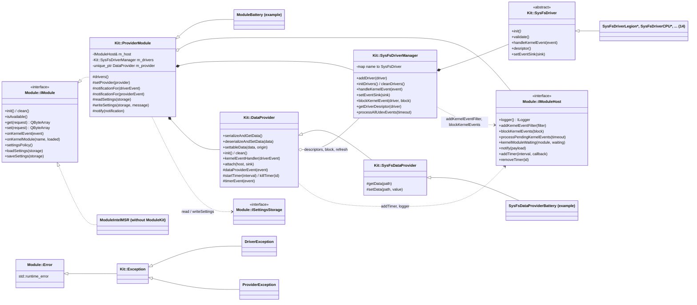
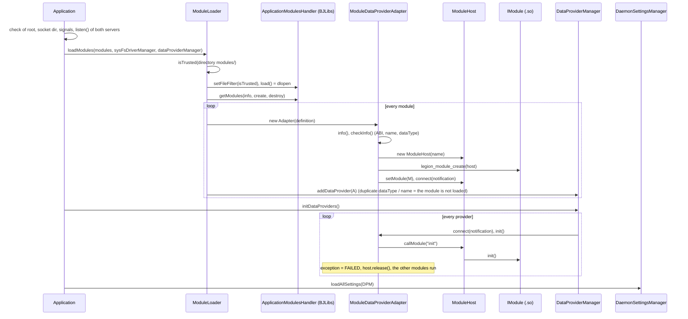
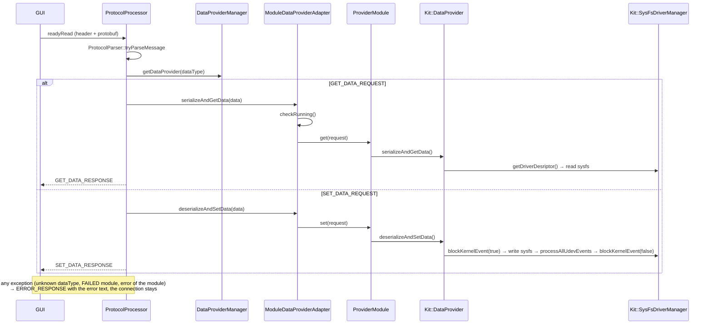
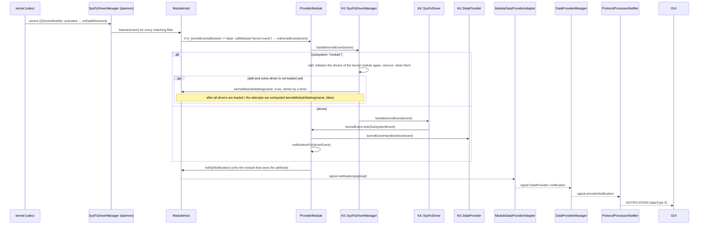
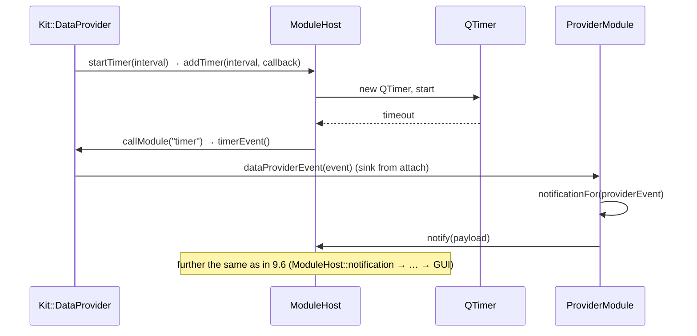
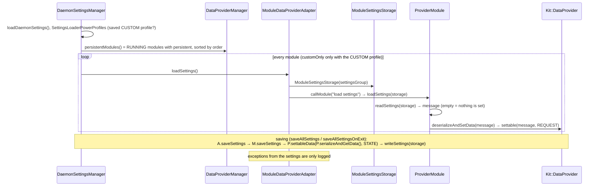

# LenovoLegion-Daemon – framework and modules

State: design, nothing changed in the code yet.

Goal: turn the daemon into a **generic framework** (protocol, authorization, loading of modules, life cycle, udev, settings, logging, fault isolation) that knows no specific hardware. All the knowledge of the hardware (today `SysFsDrivers/`, `SysFsDataProviders/`, `DataProviders/`) will be in **modules**, which are as independent of the framework and of each other as possible. The result should be a more robust system: an error of one module does not affect the others nor the connection with the GUI.

---

## 1. Current state

**Drivers (16)** inherit from `SysFsDriver`. A provider communicates with them in two ways:

- **At run time only by the name:** `SysFsDriverManager::getDriverDesriptor(DRIVER_NAME)` returns the map `name → path in sysfs`.
- **At compile time by the header of the driver:** a helper structure (e.g. `SysFsDriverLegionIntelMSR::IntelMSR`) built from that map, enums of the events and `DRIVER_NAME`.

A driver is basically a holder of the sysfs paths and a reaction to the udev events. It makes no sense on its own, some provider always uses it.

**Providers (17 sysfs and 3 others)** inherit from `DataProvider`:

- the interface consists of `serializeAndGetData`, `deserializeAndSetData`, `init`, `clean` and `kernelEventHandler`,
- they are identified by `dataType` from the central `MessageRegistry.proto`,
- from the driver manager they use only `getDriverDesriptor`, `getDriverDescriptorsInVector`, `blockKernelEvent`, `refreshDriver` and `processAllUdevEvents`.

**Dependencies of the providers on the drivers:**

| Provider | Drivers |
|---|---|
| Battery | LegionGameZone, PowerSuplyBattery0 |
| CPUFrequency | CPUXList |
| CPUInfo | CPUInfo |
| CPUOptions | CPUXList |
| CPUPower | LegionOther |
| CPUPState | CPUIntelPState |
| CPUSMT | CPU, CPUXList |
| CPUTopology | CPU, CPUAtom, CPUCore |
| FanCurve | LegionFanMode |
| FanOption | LegionOther |
| GPUPower | LegionOther |
| HWMon | CPUXList, IntelPowercapRapl, LegionHWMon |
| IntelMSR | LegionIntelMSR |
| MachineInformation | LegionMachineInformation |
| Other | LegionEvents, LegionGameZone |
| OtherGpuSwitch | LegionGameZone |
| PowerProfile | LegionGameZone, LegionOther |
| *RGBController* | *LegionEvents (events)* |
| *NvidiaNvml, DaemonSettings* | *no driver* |

`SysFsDriverACPIPlatformProfile` is only registered in `Application`, no provider or notifier uses it. A candidate for removal.

**The framework already hardly depends on the content of the messages.** `ProtocolProcessor` sends the payload as opaque bytes and routes it only by `dataType`. The only places that know specific hardware or messages:

1. **`Application` (constructor):** hard-codes the registration of 16 drivers and 20 providers.
2. **`ProtocolProcessorNotifier`:** converts the events of 6 specific drivers and 2 providers to the message `Notification`.
3. **`DaemonSettingsManager` and `Settings.h`/`Settings.cpp`:** 27 classes for loading and saving the settings, one for every provider, and a fixed order of application (the power profile first, some only in the custom mode).
4. **Central `.proto` in `LenovoLegion-PrepareBuild`:** all messages, the enum `DataType` and the enum of the actions in `Notification`.

**BJLibs already has a module mechanism:**

- `ApplicationModulesLoader` loads `.so` from the directory `modules/` by `QLibrary` and looks up the `extern "C"` functions by name,
- the macros `APPLICATION_PLUGIN_DEF`/`DEC` declare the factory functions,
- `appInitImpl` gets `ApplicationModulesHandler`, but the daemon ignores it so far.

---

## 2. Framework and modules

### 2.1 Split of responsibilities

| Framework (daemon) | Module |
|---|---|
| socket, protocol, authorization (group `legion`) | knowledge of the hardware (sysfs, HID, NVML) |
| loading and verification of the modules (owner, permissions, ABI) | own `.proto` messages |
| life cycle, order, dependencies | reading and writing of the values, range checks |
| udev monitor and dispatch of the events | reaction to the events, own notifications |
| settings storage (per module) | content and format of its own settings |
| logger | |
| system services shared by several modules (list of CPUs, Legion WMI attributes) | |
| fault isolation (exception → module disabled, not a crash of the daemon) | |

The framework knows no message of a module. It works only with the name of the module and opaque bytes.

### 2.2 Feature modules instead of separate drivers

Module = **one feature** (today's provider) **including its drivers**. A driver used by one provider only becomes an internal detail of the module and does not leak outside. There are then no compile-time dependencies between the modules.

Drivers shared by several providers become **system services of the framework**. The modules use them through the SDK interface, not through the headers of other modules:

| Shared driver | Used by | Framework service |
|---|---|---|
| CPUXList | CPUFrequency, CPUOptions, CPUSMT, HWMon | `ICpuList` – list of the CPUs and their sysfs paths |
| CPU | CPUSMT, CPUTopology | part of `ICpuList` |
| LegionOther | CPUPower, FanOption, GPUPower, PowerProfile | `ILegionAttributes` – Legion WMI attributes (other) |
| LegionGameZone | Battery, Other, OtherGpuSwitch, PowerProfile | part of `ILegionAttributes` (gamezone) |
| LegionEvents | Other, RGBController | `ILegionEvents` – WMI events of the firmware |

The system services are generic for Legion notebooks and Linux, not for one feature, therefore they belong to the framework.

### 2.3 Own messages and a dynamic `dataType`

- Every module has its **own `.proto`**. The message is known only to the module and the GUI, not to the framework.
- `dataType` is no longer a central enum. A module is identified by its **name** (`"IntelMSR"`) and the framework assigns it a number at start (`quint8`, the format of the message header does not change).
- On connection the GUI asks with the new request `LIST_MODULES` for the list `{name, dataType, version}` and then works with the assigned numbers.
- A new module therefore needs no change of the framework or the protocol.
- Temporarily the framework may assign the numbers by today's `MessageRegistry.proto`, so that the old GUI keeps working.

### 2.4 Settings

- The framework gives a module its **own storage**: the group `[IntelMSR]` in `QSettings`, or a separate file `data/modules/IntelMSR.ini`.
- The module determines the format and the content. `Settings.cpp`/`Settings.h` become 20 small pieces in the modules.
- The framework keeps only the **order of application** and the condition **"only in the custom profile"** (`SettingsPolicy`).

### 2.5 Notifications

- `Notification.proto` contains a central enum of the actions today.
- The framework will have a generic notification `{module, payload}`. The payload is a message defined by the module. The framework only forwards it and the GUI interprets it by the module.
- The conversion of an event to a notification (today in `ProtocolProcessorNotifier`) moves to the module that logically owns the event.

### 2.6 Fault isolation and robustness

A module in a `.so` runs **in the same process** as the framework:

| Error in a module | `.so` in the daemon process | Module as a separate process |
|---|---|---|
| Exception | the framework catches it, disables the module, the rest runs | the same |
| Segfault, `abort`, infinite loop | **the whole daemon crashes or hangs** | only the module crashes, the framework restarts it |
| Memory corruption | affects the whole daemon | only the module |
| Memory or fd leak | the whole daemon | only the module |

Rules for the modules in a `.so`:

- The framework wraps **every call of a module** (`init`, get, set, event, settings) in `try/catch`.
- An exception from get/set: the framework answers the client with an error and **does not close** the connection (today `Application::notify()` disconnects the GUI).
- Repeated errors or an error in `init`: the framework **disables** the module (state `FAILED`), logs it and the other modules keep running. The GUI learns the state from `LIST_MODULES`.
- An exception must not pass through Qt code (signal/slot), that is undefined behavior. The framework therefore calls the modules directly, not through slots.

Real isolation of crashes is given only by modules as **separate processes**: the framework starts them and communicates with them over a socketpair by the same protocol that already exists. It is considerably more complex, but it makes sense for the risky parts with foreign code:

- **NVML** (proprietary `libnvidia-ml`),
- **RGB/HID** (`hidapi`, communication with the keyboard).

Recommended compromise: sysfs modules as `.so` with exception isolation, NVML and RGB later as separate processes. The module API (ch. 4) is designed so that a module in another process can be hidden behind the same interface.

---

## 3. Architecture

```
LenovoLegion-Daemon                (framework: protocol, authorization, modules, udev, settings, fault isolation)
 ├─ libLenovoLegionDaemonSDK.so    module interface, IModuleHost, system services (ICpuList,
 │                                 ILegionAttributes, ILegionEvents), SysFsDriver, logger
 ├─ libBJLibs.so                   shared (logger, exceptions – see ch. 6)
 └─ modules/                       root:root 0755, every .so root:root 0644
     ├─ libModuleIntelMSR.so       + IntelMSR.proto, internal driver LegionIntelMSR
     ├─ libModuleHWMon.so          + HWMon.proto, internal drivers IntelPowercapRapl, LegionHWMon
     ├─ libModuleNvidiaNvml.so     (optional, the only one linking libnvidia-ml)
     ├─ libModuleRGBController.so  (optional, the only one linking hidapi)
     └─ ...
```

The messages of the modules are compiled into the library of the module (`libModuleX.so`) and the GUI. No message is in more than one `.so` (see ch. 6, item 2).

---

## 4. Module API

### 4.1 Identification of a module

```cpp
// LenovoLegionDaemonSDK/ModuleApi.h
namespace LenovoLegionDaemon::Module {

constexpr uint32_t ABI_VERSION = 2;          // increment on every incompatible change of the SDK (2: onKernelModule, kernelModuleWaiting)

struct Info {
    uint32_t            abiVersion;          // must match ABI_VERSION of the framework
    const char*         name;                // "IntelMSR" – unique identification of the module
    const char*         version;             // version of the module
    const char* const*  requiredServices;    // nullptr terminated array, e.g. {"CpuList", nullptr}
};

}

/* Exported symbols, looked up by ApplicationModulesLoader */
extern "C" const LenovoLegionDaemon::Module::Info* legion_module_info();
extern "C" LenovoLegionDaemon::IModule*            legion_module_create(LenovoLegionDaemon::IModuleHost& host);
extern "C" void                                    legion_module_destroy(LenovoLegionDaemon::IModule* module);
```

The framework loads `legion_module_info()` before it creates anything:

- with a different `abiVersion` it refuses the module,
- it refuses a module with a name that is already loaded,
- it does not create a module that misses a service from `requiredServices` (only logs it).

`legion_module_destroy` frees the module in the same library in which it was created (allocator and types from one `.so`).

### 4.2 Module interface

```cpp
// LenovoLegionDaemonSDK/IModule.h
class IModule {
public:
    virtual ~IModule() = default;

    /* Lifecycle – exception from init → module FAILED, the others run */
    virtual void init()  = 0;
    virtual void clean() = 0;

    /* Data – the payload is a message of the module (protobuf), the framework does not know it */
    virtual QByteArray get(const QByteArray& request) = 0;
    virtual QByteArray set(const QByteArray& request) = 0;

    /* Kernel events – the module registers its udev filter through the host, the framework passes it only its events */
    virtual void onKernelEvent(const KernelEvent& event) {}

    /* Kernel module loaded (once all modules have its drivers ready) / removed (at once), only modules with the filter "module" */
    virtual void onKernelModule(const QString& name, bool loaded) {}

    /* Settings */
    struct SettingsPolicy {
        int  order      = 100;    // order of application at start (PowerProfile = 0)
        bool customOnly = false;  // apply only with a saved CUSTOM profile (FanCurve, CPUPower, GPUPower)
        bool persistent = false;  // the module saves settings
    };
    virtual SettingsPolicy settingsPolicy() const          { return {}; }
    virtual void loadSettings(ISettingsStorage& storage)   {}   // load the saved settings and apply them
    virtual void saveSettings(ISettingsStorage& storage)   {}   // read the state and save it
};
```

### 4.3 Framework interface for a module

```cpp
// LenovoLegionDaemonSDK/IModuleHost.h
class IModuleHost {
public:
    virtual ~IModuleHost() = default;

    /* Logging (shared logger of the framework, see ch. 6 item 1) */
    virtual ILogger& logger() = 0;

    /* Kernel events */
    virtual void addKernelEventFilter(const KernelEvent::Filter& filter) = 0;
    virtual void blockKernelEvents(bool block) = 0;                     // only the events of this module
    virtual void processPendingKernelEvents(int timeoutInMiliseconds) = 0;
    virtual void kernelModuleWaiting(const QString& kernelModule, bool waiting) = 0;  // the module is still initializing the drivers of the kernel module

    /* Notification to clients – the payload is a message of the module */
    virtual void notify(const QByteArray& payload) = 0;

    /* Shared system services */
    virtual ICpuList&          cpuList() = 0;
    virtual ILegionAttributes& legionAttributes() = 0;
    virtual ILegionEvents&     legionEvents() = 0;
};
```

The module does not get `SysFsDriverManager`, `DataProviderManager` nor another module. It sees only `IModuleHost`.

### 4.4 Loading in the framework

```
appInitImpl(modules):
  1. verify modules/ (root:root, no write for the group and the others), the same as prepareSocketDir()
  2. modules->load()                                      (ApplicationModulesLoader)
  3. for every .so: verify the owner and the permissions, legion_module_info() → ABI, name, requiredServices
  4. legion_module_create(host) → assign dataType → init() in try/catch (error → FAILED)
  5. load the settings by settingsPolicy (order, customOnly), every module in try/catch
appStopImpl:
  save the settings → clean() → legion_module_destroy() of all modules → only then modules->unload()
```

---

## 5. Mapping of the files to the modules

**Feature modules (provider + its internal drivers):**

| Module | From the provider | Internal drivers | Framework services |
|---|---|---|---|
| `Battery` | SysFsDataProviderBattery | PowerSuplyBattery0 | LegionAttributes |
| `CPUFrequency` | SysFsDataProviderCPUFrequency | – | CpuList |
| `CPUInfo` | SysFsDataProviderCPUInfo | CPUInfo | – |
| `CPUOptions` | SysFsDataProviderCPUOptions | – | CpuList |
| `CPUPower` | SysFsDataProviderCPUPower | – | LegionAttributes |
| `CPUPState` | SysFsDataProviderCPUPState | CPUIntelPState | – |
| `CPUSMT` | SysFsDataProviderCPUSMT | – | CpuList |
| `CPUTopology` | SysFsDataProviderCPUTopology | CPUAtom, CPUCore | CpuList |
| `FanCurve` | SysFsDataProviderFanCurve | LegionFanMode | – |
| `FanOption` | SysFsDataProviderFanOption | – | LegionAttributes |
| `GPUPower` | SysFsDataProviderGPUPower | – | LegionAttributes |
| `HWMon` | SysFsDataProviderHWMon | IntelPowercapRapl, LegionHWMon | CpuList |
| `IntelMSR` | SysFsDataProviderIntelMSR | LegionIntelMSR | – |
| `MachineInformation` | SysFsDataProviderMachineInformation | LegionMachineInformation | – |
| `Other` | SysFsDataProviderOther | – | LegionAttributes, LegionEvents |
| `OtherGpuSwitch` | SysFsDataProviderOtherGpuSwitch | – | LegionAttributes |
| `PowerProfile` | SysFsDataProviderPowerProfile | – | LegionAttributes |
| `NvidiaNvml` | DataProviderNvidiaNvml | – | – (optional, candidate for a separate process) |
| `RGBController` | DataProviderRGBController + `RGBControlers/` | – | LegionEvents (optional, candidate for a separate process) |

**Framework:**

| Files | Where |
|---|---|
| SysFsDriverCPUXList.*, SysFsDriverCPU.* | service `ICpuList` |
| SysFsDriverLegionOther.*, SysFsDriverLegionGameZone.* | service `ILegionAttributes` |
| SysFsDriverLegionEvents.* | service `ILegionEvents` |
| SysFsDriverLegion.h | SDK (common definitions) |
| DataProviderDaemonSettings.* | framework (settings of the daemon itself) |
| SysFsDriverACPIPlatformProfile.* | used by nobody – remove |
| Settings.*, DaemonSettingsManager.* | framework only the storage and the order, the content to the modules |
| ProtocolProcessorNotifier.* | framework only forwards `{module, payload}`, the conversion to the modules |

The optional modules `NvidiaNvml` and `RGBController` allow building and installing the daemon without CUDA (today a mandatory dependency `cuda` in `PKGBUILD`) and without `hidapi`.

---

## 6. Technical pitfalls

1. **Logger separately in every `.so` (verified in the code).** `LoggerHolder` is a template singleton with a static variable and BJLibs is compiled with `--no-gnu-unique`. Every module would therefore have **its own uninitialized logger** and the first `LOG_*` in a module would throw the exception "The log file engine was not initialized".
   → Solution: pass the logger through `IModuleHost::logger()`, or build BJLibs as a shared library.

2. **Protobuf messages in more than one `.so`.** If the same `*.pb.cc` were linked into more libraries, protobuf would register the messages in the global pool more than once and on loading the second library it would end with a fatal error ("File already exists in database").
   → Solution: a message of a module is only in its `.so` (and in the GUI, which is another process). The shared messages of the framework (header, `LIST_MODULES`, generic notification) are only in the SDK.

3. **Exception types and RTTI across the `.so` boundary.** `DEFINE_EXCEPTION` creates types that are caught through the base class `bj::framework::exception::Exception`. This works only when the base class is in one shared library and the modules are compiled by the same compiler. The framework additionally catches `std::exception` and `...`.

4. **Security: a root daemon loads `.so`.** Whoever can write into `modules/` runs code as root.
   - `modules/` and its content must belong to `root:root` with the permissions `0755`/`0644`, **unlike** `log/` and `data/`, which the group `legion` can write.
   - Before loading, the framework checks the owner and the permissions of the directory and of every `.so`.
   - State it explicitly in `tmpfiles.d` and `PKGBUILD`.

5. **Unloading of the modules.** The objects of a module (including `QObject`, timers and signal connections) must be destroyed before `dlclose`. Load the modules once at start and unload them only after `legion_module_destroy`. Do not use `ApplicationModulesLoader::reload()` at run time.

6. **Exceptions through Qt.** An exception that passes through Qt code (signal/slot, `QTimer`) is undefined behavior. The framework calls the methods of a module directly and wraps every call in `try/catch`. Modules with their own timers must catch the exceptions themselves (a helper in the SDK helps).

---

## 7. Recommended procedure

Every step can be built and tested separately. Steps 1–4 improve the robustness even without modules.

1. **Fault isolation in the framework:** wrap the calls of the providers in `try/catch`, an error answer instead of disconnecting the client (replaces today's behavior of `Application::notify()`).
2. **System services:** turn `CPUXList`/`CPU`, `LegionOther`/`LegionGameZone` and `LegionEvents` into the interfaces `ICpuList`, `ILegionAttributes` and `ILegionEvents` and convert the providers to them.
3. **Settings into the providers:** `SettingsPolicy`, `loadSettings`/`saveSettings`, the framework only the storage and the order. Removes 27 classes in `Settings.h`.
4. **Notifications into the providers:** conversion of the events from `ProtocolProcessorNotifier` into the providers.
5. **SDK and logger:** `libLenovoLegionDaemonSDK.so` with `IModule`, `IModuleHost` and the services, the logger through the host.
6. **Feature modules:** convert the providers including the internal drivers to `.so`, replace the registration in `Application` by loading from `modules/` including the check of the owner and the permissions. Start with the optional `NvidiaNvml` and `RGBController`, which bring the biggest benefit (removal of mandatory dependencies).
7. **Own messages and a dynamic `dataType`:** `.proto` into the modules, `LIST_MODULES` in the protocol, the GUI on the assigned numbers.
8. **Optionally:** `NvidiaNvml` and `RGBController` as separate processes.

### 7.1 Proposed order of the first steps (2026-10-22, not approved yet)

Do not design the whole API up front, verify it at once on a pilot module:

1. **DONE (2026-10-22, not committed):** **Fault isolation** in `ProtocolProcessor::processRequest` (try/catch, an error answer instead of disconnecting the client). Corresponds to step 1 above.
   - New message type `MessageHeader::ERROR_RESPONSE = 5`, the payload is a UTF-8 description of the error.
   - Daemon: an exception from a provider and an unknown `dataType` → `LOG_E` + `ERROR_RESPONSE`, the connection stays. Parser errors (invalid length) still close the connection.
   - GUI: `ProtocolProcessor::get/setDataRequest` returns `{false, description}`, `DataProvider::throwRequestError` throws an exception with the code `DAEMON_ERROR` and the text from the daemon.
   - Verified by a test in `/tmp` (real `ProtocolProcessor`, fake provider): error → type 5 with a text, unknown `dataType` → type 5, the next request works, the client stayed connected.
   - Exceptions from timers and kernel events (ToDo item 7) unchanged so far.
2. **DONE as a design (2026-10-22, not committed, waits for comments):** **API as headers** in the directory `LenovoLegion/LenovoLegion-DaemonSDK/`, the subproject `LenovoLegion-DaemonSDK.pro` (`TEMPLATE = aux`, compiles nothing) is in `LenovoLegion.pro` only to be shown in Qt Creator. **The headers are binding, ch. 4 is only the original sketch.**
   - `ModuleTypes.h` – `KernelEvent` (+ `Filter`), `ILogger`, `ISettingsStorage`, timer types.
   - `IModuleHost.h` – framework interface for one module (logger, udev filters, blocking and processing of the events, `notify`, `addTimer`/`removeTimer`) and RAII `KernelEventBlocker` (replaces `blockKernelEvent` + `qScopeGuard` + `processAllUdevEvents(100)`).
   - `IModule.h` – module interface (`init`/`clean`/`isAvailable`, `get`/`set`, `onKernelEvent`, `settingsPolicy`/`loadSettings`/`saveSettings`) and the rules for the exceptions.
   - `ModuleApi.h` – `Info` (ABI version, name, version, `legacyDataType`, `settingsGroup`, `requiredServices`), types and names of the factory functions, macro `LEGION_MODULE_DECLARE_ENTRY_POINTS`.
   - Refinements against ch. 4: timers through the framework (the framework catches the exceptions from the callback), temporary `legacyDataType` and `settingsGroup` for the compatibility with the current GUI and `.ini`, loading/removal of a kernel module through a udev filter on the subsystem `module` (no special method), `isAvailable()`.
   - The system services (`ICpuList`, …) are not in the API yet, they come with the step "system services".
   - Verified: a fake module in `/tmp` built as a `.so` with `-Wall -Wextra -fvisibility=hidden` exports only `legion_module_info`, `legion_module_create`, `legion_module_destroy`.
3. **DONE (2026-10-23, not committed, waits for a test of the author as root with the GUI):** **Pilot `IntelMSR` as an `IModule` inside the daemon** (without `.so`, through an adapter in the framework).
   - Module: `LenovoLegion/LenovoLegion-DaemonModules/IntelMSR/` (`ModuleIntelMSR.h/.cpp`). Own project `IntelMSR.pro` (static library `libDaemonModuleIntelMSR.a` in `Lib/`), `LenovoLegion-DaemonModules.pro` is `subdirs` with the list of the modules. The daemon links it (`LIBS`, `PRE_TARGETDEPS`), `LenovoLegion-Daemon.depends` contains `LenovoLegion-DaemonModules`. `IntelMSR.pro` sets `INCLUDEPATH` again (only the module, SDK, `LenovoLegion-PrepareBuild`), because `.qmake.conf` adds BJLibs and `LenovoLegion-Daemon` to all projects – the compiler thus ensures that the module uses nothing from the daemon. It uses only the SDK, Qt Core and the messages `CpuIntelMSR`, `Notification`, `MessageRegistry`. The class is hidden in the `.cpp`, only `info()`/`create()`/`destroy()` are visible (+ `create(host, sysfsPath)` for tests).
   - SDK extended: `Module::Error` (`ModuleTypes.h`), `SysFs.h` (`exists`/`read`/`write`, an unbuffered write returns `false` when the kernel refuses it), `<chrono>` in `IModuleHost.h`.
   - Framework (`LenovoLegion-Daemon/Modules/`): `ModuleHost` (implementation of `IModuleHost`, `QPointer` to `SysFsDriverManager`, `callModule` with try/catch, timers through `QTimer`), `ModuleDataProviderAdapter` (module as a `DataProvider`, states CREATED/RUNNING/FAILED, check of `Info`), `ModuleSettingsStorage` (`ISettingsStorage` over the same `.ini`), `StaticModules` (list of the statically linked modules).
   - Changes: `SysFsDriverManager` – listeners of kernel events for the modules (`addKernelEventListener`/`removeKernelEventListeners`, the filters are restored also after `reconnectUdevMonitor`); `DataProvider` – virtual `loadSettings()`/`saveSettings()` and the signal `notification(QByteArray)`; `DataProviderManager` – signal `providerNotification`; `ProtocolProcessorNotifier` – `providerNotificationHandler` (sends `NOTIFICATION` with the payload of the module); `Application` – registration from `staticModules()` instead of `SysFsDriverLegionIntelMSR` and `SysFsDataProviderIntelMSR`; `DaemonSettingsManager::loadIntelMSR`/`saveIntelMSR` call `loadSettings()`/`saveSettings()` of the provider.
   - `SysFsDriverManager.h` includes the SDK by a relative path (`../LenovoLegion-DaemonSDK/ModuleTypes.h`), because the GUI includes it as well through the headers of the providers.
   - Intentional differences against the old behavior: (1) with an unavailable device the settings are **not saved** (the old saving overwrote the saved offsets with zero), (2) a SET with an unavailable device is only logged (formerly an exception), (3) a sysfs write error is logged (item 3 of `ToDoList.txt` for this module), the other planes are written. Rounding of the offset to whole mV on saving is kept.
   - Verified by tests in `/tmp`: the module with a fake host and a fake sysfs (get, set of the present planes only, blocking of events, write error, notification `CPU_OFFSET_CHANGED`, saving with rounding, loading, removal/loading of the kernel module, invalid message → `Error`) and the framework with the real udev and the real sysfs of this notebook (reading through the adapter, saving to `.ini` in the same format as before).

   **To be deleted after the verification of the pilot (the author wished to keep it for now):**
   - `SysFsDrivers/SysFsDriverLegionIntelMSR.h/.cpp`,
   - `SysFsDataProviders/SysFsDataProviderIntelMSR.h/.cpp` (the GUI uses `SysFsDataProviderIntelMSR::dataType` in 4 places – `OffsetsControl.cpp`, `ToolBarProfilesWidget.cpp` – replace by `legion::messages::DataType::CPU_INTEL_MSR`),
   - `SettingsLoaderIntelMSR`/`SettingsSaverIntelMSR` in `Settings.h/.cpp`,
   - the branch `SysFsDriverLegionIntelMSR::DRIVER_NAME` and the include in `ProtocolProcessorNotifier.cpp`,
   - the entries in `LenovoLegion-Daemon.pro`.
4. **Adjustment of the API by the pilot**, then the rest of the procedure.

### 7.2 Dynamic modules (`.so`) – plan of 2026-10-23

Verified by tests: BJLibs `ApplicationModulesLoader` can load a `.so` and find the factory functions (`getModules<...>`). When both the module and the daemon contain the same protobuf message, the daemon **crashes at `dlopen`** ("File already exists in database") – the messages must be in a shared library.

1. **DONE (not committed):** shared library of the messages `LenovoLegion-Messages/` (`libLenovoLegionMessages.so` in `Installation/`, `plugin` = without the version symlinks). The daemon and the GUI use it through `LenovoLegion-Messages.pri` (`LIBS`, `PRE_TARGETDEPS`, `rpath $ORIGIN`), they no longer compile their own `*.pb.cc`. Verified: the registration of the messages (`descriptor_table_*`) is only in the library, the binaries contain only weak inline methods; the GUI starts.
2. **DONE (not committed):** BJLibs `ApplicationModulesLoader` (backward compatible):
   - `setFileFilter(FileFilter)` – `bool(const QFileInfo&, QString& reason)`, called before loading every file, the default accepts everything,
   - `errors()` – `{m_file, m_reason}` for the files refused by the filter, errors of `QLibrary::load` (`errorString()`) and libraries without the symbols requested in `getModules`,
   - default suffix `defaultSuffix()` = `\.(so|dll)$`, compared with the file name (formerly `".dll|so$"` on the whole path),
   - only files (`QDir::Files`), directories are ignored, sorted by name,
   - `ApplicationModulesHandler`: `setFileFilter`, `errors`, `path`,
   - unit test `test_modulesLoader` in `BJLibs-UnitTests` (copy of the system `libz`, refusal by the filter, corrupted library, suffixes, missing symbol).
3. **DONE (not committed):** the **daemon** loads the modules only dynamically, `StaticModules` removed (decision of the author).
   - `Modules/ModuleLoader` – `loadModules(handler, drivers, providers)` called in `appInitImpl` after `initDrivers()` and before `initDataProviders()`; `getModules<InfoFn, CreateFn, DestroyFn>` with the symbols from `ModuleApi.h`; an error of one module (ABI, duplicate name or `dataType`, exception) is logged and the module is skipped; the errors of the loader (`errors()`) are logged; `unload()` is not called (the libraries stay loaded until the end of the process).
   - Security filter `isTrusted`: `lstat` (symlinks are not accepted), directory / regular file, owner **root or the owner of the daemon binary** (a development build belongs to the developer – whoever owns the binary can replace it anyway), no write for the group and the others. Untrusted directory → no module is loaded.
   - `ModuleDataProviderAdapter::Definition` uses `std::function` (that is how the loader returns them), new method `info()`.
   - SDK: macro `LEGION_MODULE_VISIBLE` (visibility `default`) on `Error`, `ILogger`, `ISettingsStorage`, `IModuleHost`, `IModule` – typeinfo and vtable across the `.so` boundary even with `-fvisibility=hidden`.
   - The daemon no longer depends on `LenovoLegion-DaemonModules` (not even when linking).
4. **DONE (not committed):** **Module `IntelMSR.pro`:** `TEMPLATE = lib`, `CONFIG += plugin hide_symbols`, `DESTDIR = Installation/modules/`, `rpath $ORIGIN/..`, `-Wl,--no-undefined -Wl,--as-needed`, links `libLenovoLegionMessages.so`. Exported entry points `legion_module_info/create/destroy` (`LEGION_MODULE_DECLARE_ENTRY_POINTS`) in `ModuleIntelMSR.cpp`. Verified: only 3 symbols exported, no registration of messages in the module, the code of the module is not in the daemon.
5. **DONE (not committed):** **Package:** `PKGBUILD` – `modules/` 0755, `*.so` 0644, `tmpfiles.d` – `d /opt/<pkg>/modules 0755 root root -`.

Verified by an end-to-end test in `/tmp` (real `ModuleLoader` + BJLibs loader + `.so` of the module): directory writable by the group → nothing is loaded; module writable by the group → refused with the reason in the log; correct permissions → the module is loaded and reads the real sysfs through `DataProviderManager`.

Note: when a module is missing (not installed or refused), the GUI gets `ERROR_RESPONSE` "Data provider not found" for its `dataType` and shows an error. For the optional modules (NVML, RGB) the GUI will need to handle a missing module (e.g. through `LIST_MODULES`).

Side finding: when the daemon cannot open the log, `main.cpp` exits with the code 0 (systemd does not restart it), the same as item 6 in `ToDoList.txt`.

### 7.3 Conversion of all providers to modules (2026-10-24, not committed, waits for a test of the author as root with the GUI)

Decision of the author: shared drivers as source code without sharing at run time (variant A), the notification is owned by the module that writes the attribute, the settings "only in the custom profile" are temporarily handled by `DaemonSettingsManager`. The old code stays (unused), it is deleted after the verification (list below and in `ToDoList.txt`).

**`LenovoLegion-DaemonModules/ModuleKit/`** (static library `libDaemonModuleKit.a`, linked into every module, nothing shared at run time):
- `SysFsDriver`, `SysFsDriverManager`, `DataProvider`, `SysFsDataProvider` – the same interface as in the daemon (the code of the providers and drivers is converted mechanically), without `QObject` and BJLibs, connected to `IModuleHost`: `emit kernelEvent/dataProviderEvent` are ordinary methods, `startTimer/killTimer/timerEvent` through the timers of the host, `LOG_*` through the logger of the host (`KitLog.h`), `THROW_EXCEPTION`/`DEFINE_EXCEPTION`/`errcodeInfo`/`descriptionInfo` in `KitException.h` (exceptions derived from `Module::Error`).
- `SysFsDriverManager` (kit): one udev filter per subsystem with merged properties (the old `SysFsDriverManager` passed `EVENT_TYPE` to the drivers on `wmi` by the order in the map), filter `module` – when the kernel module is loaded the drivers are initialized again, an error of a driver is logged and the driver is cleaned; drivers that are not loaded yet (the kernel module creates the sysfs files only a while after the event, `lenovo_legion` binds the WMI parts later) are retried after 250 ms at most 12 times and meanwhile the module reports `kernelModuleWaiting(module, true)`; on removal the drivers are cleaned.
- `SysFsDataProvider::setData` (kit): unbuffered write, a failed open throws an exception (as before), a write error is logged (item 3 of `ToDoList.txt`).
- `ProviderModule` – generic `IModule` over a provider and its drivers: hooks `notificationFor` (events of the drivers and of the provider), `readSettings`/`writeSettings` (conversion of the message to keys), helpers `notification`, `eventType`, `arrayKey`/`arraySizeKey` (arrays in the `QSettings` format), `serialize`/`parse`.
- `ModuleEntry.h` – macro `LEGION_KIT_MODULE(class, name, version, dataType, settings group)` for the entry points.
- `ModuleKit.pri` – common settings of a module `.pro` (`plugin`, `hide_symbols`, `INCLUDEPATH` only kit/SDK/messages, `libLenovoLegionMessages.so`, `rpath $ORIGIN/..`, `--no-undefined`, `--as-needed`).
- `Drivers/` – 14 drivers moved from the daemon (without IntelMSR and the unused ACPIPlatformProfile), the `wmi` filters have the properties `EVENT_TYPE`/`EVENT_VALUE`.

**Modules (18 new + IntelMSR, every one `Installation/modules/libDaemonModule<Name>.so`):**

| Module | Drivers | Notifications | Settings (group, order) |
|---|---|---|---|
| MachineInformation | LegionMachineInformation | `LENOVO_DRIVER_ADDED/REMOVED` (kernel module `lenovo_legion`) | – |
| CPUInfo | CPUInfo | – | – |
| Battery | LegionGameZone, PowerSuplyBattery0 | `POWER_SUPPLY_BATTERY0_CHANGE` | – |
| HWMon | CPUXList, IntelPowercapRapl, LegionHWMon | – | – |
| PowerProfile | LegionGameZone, LegionOther, LegionEvents | `THERMAL_MODE_CHANGE` | PowerProfileData, 0 |
| CPUOptions | CPUXList | `CPU_X_LIST_RELOADED` | CPUsControlData, 10 |
| CPUFrequency | CPUXList | `CPU_FREQUENCY_CHANGED` (timer) | CPUFrequencyData, 20 |
| FanCurve | LegionFanMode | `FAN_CURVE_CHANGED` (LegionFanMode) | FanCurveData, 30, custom |
| CPUPower | LegionOther | `POWER_CONTROL_CHANGED` (CPU_*, APU_PPT, GPU_TAC) | CPUPowerData, 40, custom |
| GPUPower | LegionOther | `POWER_CONTROL_CHANGED` (GPU_PB, GPU_TGP, GPU_TMP) | GPUPowerData, 50, custom |
| FanOption | LegionOther | `FAN_CURVE_CHANGED` (FF_S) | FanOptionData, 60 |
| CPUSMT | CPU, CPUXList | – | CPUSMTData, 70 |
| NvidiaNvml | – (links `libnvidia-ml`) | – | NvidiaNvmlData, 80 |
| IntelMSR | own | `CPU_OFFSET_CHANGED` | IntelMSRData, 90 |
| Other | LegionEvents, LegionGameZone | `KEYLOCK_STATUS_CHANGE` | OtherData, 100 |
| CPUPState | CPUIntelPState | `CPU_PSTATE_CHANGED` (timer) | CPUPStateData, 110 |
| CPUTopology | CPU, CPUAtom, CPUCore | – | – |
| OtherGpuSwitch | LegionGameZone | – | – |
| RGBController | LegionEvents (links `hidapi`, contains `RGBControlers/`) | `SPECIAL_KEY_PRESSED` | – |

Deviations from the original table (by the rule "the notification is sent by whoever writes the attribute"): `FF_S` is owned by FanOption (writes `fan_full_speed`), `CPU_X_LIST_RELOADED` is owned by CPUOptions (writes the online state of the CPUs; a change of SMT from CPUSMT is notified as well – the GUI only refreshes the CPU controls once more), `GPU_TAC` is owned by CPUPower (writes `gpu_total_onac`).

**Framework:** `Application` registers only `DataProviderDaemonSettings`, everything else are modules. `DaemonSettingsManager::loadAllSettings/saveAllSettings` go through the modules by `settingsPolicy().order` (`persistentModules`), the modules with `customOnly` are loaded only with a saved CUSTOM profile (the detection of the profile stays the old one). `ModuleDataProviderAdapter::settingsPolicy()`.

**Verified** by a comparison program (`/tmp/legion-tools/compare`, the old providers against the modules on this notebook, read only): all modules except RGB return the same data, the differences are only in the values that change between the reads (energy, current frequency, PCIe throughput). RGB cannot be compared without root (`/dev/hidraw*` only for root) – only the loading and the initialization verified. The saved settings (`saveAllSettings` through the modules against the old functions `save*`) are the same in all groups including the arrays. Loading of the settings not tested (writes to the hardware).

**DELETED 2026-10-27 (not committed)** – the old implementations by the list below:
- daemon: `SysFsDrivers/`, `SysFsDataProviders/`, `RGBControlers/`, `SysFsDriver.*`, `SysFsDataProvider.*`, `RGBController.*`, `RGBControllerDetector.h`, `StringUtils.*`, `DataProviders/DataProviderNvidiaNvml.*`, `DataProviders/DataProviderRGBController.*`,
- `SysFsDriverManager` is only a udev monitor for the modules (listeners, `processAllUdevEvents`, restoring of the monitor), the support of the old drivers and the signals `kernelEvent`/`moduleSubsystem` removed; `DataProvider::kernelEventHandler` and `DataProviderManager::kernelEventHandler` removed, `DataProviderManager(QObject*)`,
- `ProtocolProcessorNotifier(DataProviderManager*, QLocalSocket*, QObject*)` only forwards the notifications of the modules,
- `DaemonSettingsManager` without the functions `load*/save*` for the individual providers, `Settings.h/.cpp` only `Settings`, `SettingsLoaderPowerProfiles` (detection of the CUSTOM profile) and `SettingsLoader/SaverDaemonSettings`,
- `LenovoLegion-Daemon.pro` without `hidapi`, CUDA and `libnvidia-ml` – the daemon depends only on `libLenovoLegionMessages.so` and `libudev` (binary ~12 MB instead of ~43 MB),
- the GUI uses `legion::messages::DataType::*` instead of `LenovoLegionDaemon::*::dataType`.

Stays in `LenovoLegion-Daemon`: `RGBControllerKeyNames.h` – key names shared with the GUI (`Ui/KeyboardLayout.cpp`, the module RGBController has its own copy in `Kit`). `RGBControllerInterface.h` is not needed by the GUI after the removal of the old keyboard widgets, it is only in the module. A candidate for moving to a common place (e.g. next to the messages).

Verified: the whole build without errors and warnings, all 19 modules are loaded and return data (test with the new objects of the daemon), the GUI starts.

**Original list to delete:**
- `LenovoLegion-Daemon/SysFsDrivers/*`, `SysFsDataProviders/*`, `DataProviders/DataProviderNvidiaNvml.*`, `DataProviders/DataProviderRGBController.*`, `RGBController.*`, `RGBControlers/*`, `RGBController*.h`, `StringUtils.*`, `SysFsDataProvider.*`, `SysFsDriver.*` (unless `SysFsDriverManager` needs it – that one stays because of udev),
- the per-provider functions `DaemonSettingsManager::load*/save*` and the classes `SettingsLoader*/SettingsSaver*` in `Settings.h/.cpp` (except `PowerProfiles` – used for the detection of the CUSTOM profile – and `DaemonSettings`),
- the conversions of the events in `ProtocolProcessorNotifier` (`kernelEventHandler`, `dataProviderEventHandler`, `moduleSubsystemHandler`), only `providerNotificationHandler` stays,
- the entries in `LenovoLegion-Daemon.pro`, the dependencies of the daemon on `cuda`/`libnvidia-ml` and `hidapi` (then only the modules NvidiaNvml and RGBController have them),
- GUI: replace `LenovoLegionDaemon::SysFsDataProvider*::dataType` and `DataProvider*::dataType` by `legion::messages::DataType::*`.

---

## 8. Context for continuing the conversation

This chapter serves for continuing the work in a new conversation (Claude Code). It describes the state as of **2026-10-22**.

### 8.1 What is already done (commits in `main`)

| Commit | Content |
|---|---|
| `a6fcb6c` | daemon: `deleteLater` for the protocol processors, async-signal-safe `bj::framework::Signal` (self-pipe + `QSocketNotifier`), exception on a failure of `listen()`, `Restart=on-failure` in the service |
| `0544c42` | `log/`, `data/` as `root:legion 2770` through `tmpfiles.d`, logger with `O_NOFOLLOW`, `umask(0007)` in the daemon and the GUI |
| `ca26196` | kernel: errors of the MSR offset write are returned from `store`; protocol: message length limit 1 MiB, non-blocking `tryParseMessage` in the daemon |
| `e3fdacc` | RAPL udev rule: `root:legion 0440` (formerly `0444`, `energy_uj` was readable by everybody – CVE-2020-8694) |
| `3c22730` | `processAllUdevEvents` with a common timeout, `reconnectUdevMonitor` without a crash (retry after 5 s) |
| `9aa933d` | RGB: range check of the profile/brightness, wait timeout in real time; NVML: range check of the offsets, initialization of min/max; GUI: order of termination; exception from `init` of a driver on loading the module; CPU frequency: polling only `scaling_min/max`, fix of an index in `init()` |
| `ddd1667` | GUI: the power profile switches load the state again after a SET; update of `ToDoList.txt` |

The remaining known problems are in `LenovoLegion/ToDoList.txt`.

### 8.2 Decisions and preferences of the author

- **Invalid request from a client:** the daemon **only logs it (`LOG_E`) and ignores it**, it does not throw an exception (an exception today disconnects the GUI through `Application::notify()`). After a SET the GUI loads the value again and shows the real state.
- **Sysfs write errors:** logging them is enough, without a change of the protocol (item 3 in `ToDoList.txt`).
- **Blocking of own kernel events** during a SET (`blockKernelEvent` + `processAllUdevEvents(100)`) stays, the author does not want to change it.
- **Permissions:** `log/`, `data/` writable by the group `legion`, nothing for the others. `modules/` will be for root only.
- **`bj::framework::Signal`** stays in BJLibs, it is used in other projects as well.
- **Commit messages in English**, in the style of the repository (imperative mood in the subject, bullets in the body). The author makes the commits himself, Claude only proposes the message.
- **`ToDoList.txt` in English.** Communication with the author in Czech.
- Before a bigger change a proposal first, the implementation only after the approval.

### 8.3 Environment

- Repository: `/home/bojar/Git-projects/lenovo-legion-linux-toolkit`, branch `main`.
- Qt 6.12 (`/home/bojar/Qt/6.12.0/gcc_64`), Qt Creator, build directory `LenovoLegion/build/Desktop_Qt_6_12_0_Debug`.
- Build: `make -j24` in the build directory (or `build` through the Qt Creator MCP). The kernel module can be built in a copy in `/tmp` (`make -C <copy> all`), the headers of the running kernel are available.
- Claude does not test the daemon and the GUI at run time (the daemon needs root, the GUI a running daemon). Verification by building and small tests in `/tmp`.

### 8.4 Open questions about the modules

- Approve the order in ch. 7.1 (fault isolation → API headers → pilot `IntelMSR`).
- Logger in the modules: through `IModuleHost::logger()`, or BJLibs as a shared library?
- Switch to the dynamic `dataType` (`LIST_MODULES`) at once, or only after the conversion of all modules (temporarily the numbers by `MessageRegistry.proto`)?
- Remove the unused `SysFsDriverACPIPlatformProfile`?

## 9. Class and communication diagrams

State after the conversion of all modules and the deletion of the old code (2026-10-29). The diagrams are in Mermaid (Qt Creator / GitHub show them), arrows:
`<|--` inheritance, `*--` ownership, `o--` reference without ownership, `..>` call / signal.

### 9.1 Binaries and libraries

```
                  +----------------------------------+
                  |  libLenovoLegionMessages.so      |   protobuf messages, only once in a process
                  +----------------------------------+
                     ^             ^              ^
                     |             |              |
+--------------------+--+   +------+--------+   +-+-----------------------------------+
| LenovoLegion (GUI)    |   | daemon        |   | modules/*.so  (19 modules)          |
| QLocalSocket x2       |   | framework     |   |  ModuleKit (staticlib, in source)   |
+-----------+-----------+   | + BJLibs      |   |  + drivers ModuleKit/Drivers        |
            |               | + libudev     |   |  + own provider of the module       |
            |  socket       +------+--------+   +-+-----------------------------------+
            |  (requests,          |   dlopen      ^
            |   notifications)     +---------------+  only through the C ABI: legion_module_info/create/destroy
            +--------------------->|                  and the interfaces of LenovoLegion-DaemonSDK (IModule, IModuleHost)
```

The daemon links no module, a module does not link the daemon (`-Wl,--no-undefined`). Only the SDK headers and the message library are common.

### 9.2 Framework of the daemon (LenovoLegion-Daemon)

```mermaid
classDiagram
    direction LR

    class QCoreApplication
    class ApplicationInterface["bj::framework::ApplicationInterface"]
    class Application {
        -QLocalServer* m_serverSocket
        -QLocalServer* m_serverSocketNotification
        -SysFsDriverManager* m_sysFsDriverManager
        -DataProviderManager* m_dataProviderManager
        -ProtocolProcessorBase* m_protocolProcessor
        -ProtocolProcessorBase* m_protocolProcessorNotification
        +appInitImpl(modules)
        +appStopImpl()
        +newConnectionHandler()
        +newConnectionNotificationHandler()
        -acceptConnection~Processor~(server, processor, name)
        -deleteProtocolProcessor(processor)
    }
    QCoreApplication <|-- Application
    ApplicationInterface <|-- Application

    class ProtocolProcessorBase {
        <<QObject>>
        #QLocalSocket* m_clientSocket
        +start()
        #readyReadHandlerSlot() try/catch
        #dropClient(reason)
        #disconnectedHandler()
        signal clientDisconnected()
    }
    class ProtocolProcessor {
        +processRequest(header, data)
        -sendMessage(type, dataType, data)
    }
    class ProtocolProcessorNotifier {
        +providerNotificationHandler(payload)
    }
    class ProtocolParser {
        +tryParseMessage()
        MAX_MESSAGE_LENGTH = 1 MiB
    }
    ProtocolProcessorBase <|-- ProtocolProcessor
    ProtocolProcessorBase <|-- ProtocolProcessorNotifier
    ProtocolProcessorBase ..> ProtocolParser : parses

    class DataProviderManager {
        <<QObject>>
        -map dataType to DataProvider*
        +addDataProvider(p)
        +initDataProviders()
        +cleanDataProviders()
        +getDataProvider(dataType)
        +forEachDataProviderDo(fn)
        signal providerNotification(payload)
    }
    class DataProvider {
        <<QObject>>
        +quint8 m_dataType
        +serializeAndGetData()
        +deserializeAndSetData(data)
        +init() / clean()
        +loadSettings() / saveSettings()
        signal notification(payload)
        signal dataProviderEvent(event)
    }
    class DataProviderDaemonSettings
    class ModuleDataProviderAdapter {
        -Module::Info* m_info
        -ModuleHost* m_host
        -IModule* m_module
        -State m_state  CREATED|RUNNING|FAILED
        +info()
        +settingsPolicy()
    }
    DataProvider <|-- DataProviderDaemonSettings
    DataProvider <|-- ModuleDataProviderAdapter

    class IModuleHost["Module::IModuleHost (SDK)"] {
        <<interface>>
    }
    class ModuleHost {
        <<QObject>>
        -QPointer~SysFsDriverManager~ m_sysFsDriverManager
        -IModule* m_module
        -map TimerId to QTimer*
        -bool m_kernelEventsBlocked
        +setModule(module)
        +release()
        +callModule(what, call) noexcept
        signal notification(payload)
    }
    IModuleHost <|.. ModuleHost

    class ISettingsStorage["Module::ISettingsStorage (SDK)"] {
        <<interface>>
    }
    class Settings {
        QSettings group
    }
    class ModuleSettingsStorage
    Settings <|-- ModuleSettingsStorage
    ISettingsStorage <|.. ModuleSettingsStorage

    class ModuleLoader {
        <<static>>
        +loadModules(modules, sysFsDriverManager, dataProviderManager)
        +isTrusted(file, directory, reason)
    }
    class SysFsDriverManager {
        <<QObject>>
        udev monitor
        +addKernelEventListener(owner, filter, listener)
        +removeKernelEventListeners(owner)
        +addKernelModuleListener(owner, listener)
        +setKernelModuleWaiting(owner, module, waiting)
        +processAllUdevEvents(timeout)
        -onDataReceived()
    }
    class DaemonSettingsManager {
        <<singleton>>
        +loadAllSettings(manager)
        +saveAllSettings(manager)
        +saveAllSettingsOnExit(manager)
        +persistentModules(manager)
    }
    class IModule["Module::IModule (in .so)"] {
        <<interface>>
    }

    Application *-- SysFsDriverManager
    Application *-- DataProviderManager
    Application *-- ProtocolProcessor : 1 client
    Application *-- ProtocolProcessorNotifier : 1 client
    Application ..> ModuleLoader : appInitImpl
    Application ..> DaemonSettingsManager : load / save
    ModuleLoader ..> ModuleDataProviderAdapter : creates
    ModuleLoader ..> DataProviderManager : addDataProvider
    DataProviderManager o-- DataProvider : owns (QObject parent)
    ModuleDataProviderAdapter *-- ModuleHost
    ModuleDataProviderAdapter o-- IModule : create / destroy
    ModuleDataProviderAdapter ..> ModuleSettingsStorage : load / saveSettings
    ModuleHost o-- SysFsDriverManager : listener, processAllUdevEvents
    ModuleHost o-- IModule : onKernelEvent, timers
    ProtocolProcessor o-- DataProviderManager : getDataProvider
    ProtocolProcessorNotifier o-- DataProviderManager : providerNotification
    DaemonSettingsManager ..> ModuleDataProviderAdapter : persistentModules
```



The framework knows no hardware. It sees the modules only as a `DataProvider` (through `ModuleDataProviderAdapter`), the only own provider of the framework is `DataProviderDaemonSettings`.

### 9.3 Module side (LenovoLegion-DaemonSDK + ModuleKit + modules)



The entry points of a `.so` are created by the macro `LEGION_KIT_MODULE(ModuleClass, name, version, legacyDataType, settingsGroup)` from `ModuleEntry.h`, `IntelMSR` has them written by hand. The ModuleKit drivers are compiled into every module separately, they are not shared at run time.

### 9.4 Start and loading of the modules



### 9.5 GET / SET request



Blocking of the own kernel events on SET means that after its own write the GUI gets no notification and must load the values again (ToDoList 1, 5).

### 9.6 Kernel event → notification



A kernel module (subsystem `module`) is coordinated by the daemon's `SysFsDriverManager` for all modules (every module has its own copy of the static ModuleKit, therefore not in the kit):

- `add`: state PENDING, the event is delivered to all listeners; whoever is still initializing the drivers reports `kernelModuleWaiting(name, true)`. When nobody waits after the delivery (or when the last one reports `false`), `onKernelModule(name, true)` is called for all modules with the filter `module` – e.g. MachineInformation then sends `LENOVO_DRIVER_ADDED` and the GUI loads the data once the drivers of all modules are ready.
- `remove`: right after the delivery of the event `onKernelModule(name, false)` (`LENOVO_DRIVER_REMOVED`), the waiting is cancelled.
- A released module (`removeKernelEventListeners`) no longer waits; the announcement is then evaluated deferred (`QTimer::singleShot(0)`), because the daemon may just be shutting down.
- The name of the kernel module is hard-coded nowhere in the kit nor in `ProviderModule`, `ModuleMachineInformation` only filters `LEGION_MODULE_NAME` for its notification.

### 9.7 Timer → notification



### 9.8 Settings (start, saving, shutdown)



#### Profiles

The profiles are saved and applied by the daemon, the GUI has no saving of its own (`DataType::PROFILES`, `Profiles.proto`, `DataProviderProfiles`):

- GET returns the list of the profiles (name, description). SET sends `ProfileCommand` (`SAVE`, `LOAD`, `DELETE`) and the answer is the list of the profiles after the command. An invalid name or a non-existent profile returns ERROR_RESPONSE.
- A profile is the same settings of the modules as the saved settings of the daemon, only in the groups `Profiles/<name>/<settingsGroup>` of the file `LenovoLegion-Daemon.ini` (`SettingsProfiles::prefix`). `DaemonSettingsManager` has one path for both: `applyModuleSettings(prefix)` and `storeModuleSettings(prefix)`, i.e. the order of the modules, `customOnly` by the saved `PowerProfile` and `settableData`.
- `SAVE` first deletes the whole profile, so no old values remain in it after an overwrite.
- The name must not be empty, start or end with a space, contain a slash or a backslash and have more than 64 characters.
- The old GUI profiles in `LenovoLegionGui.ini` (`Profile_<name>`) are not converted.

#### What can be set (`settableData`)

The rules which fields of a message can be written to the hardware are only in the provider (`Kit::DataProvider::settableData`, for `IntelMSR` in `ModuleIntelMSR::settable`). They are used in two cases:

- **Write (`deserializeAndSetData`):** only `settable(request, REQUEST)` is written. This applies to a direct write from the GUI, loading of a GUI profile and loading of the daemon settings. A skipped field is logged as a warning, the other fields are written.
- **Saving:** only `settableData(current state, STATE)` is saved. A skipped field is logged as debug only. A field that is not written does not overwrite a previously saved value.

Rules:

- Read-only fields (descriptors, `supported`, `available_governors`, topology IDs etc.) are removed without a log.
- An invalid value is removed and logged by `skipField`.
- The limits are always taken from the hardware, not from the request, because the request contains only the values.
- `writeSettings` saves only the fields present in the message (`has_*`).
- The GUI does not know the values of the kernel. What can be set is told by the data: `supported`, ranges, `steps`, `supported_profiles`, `available_governors` and for string values a list from the same rule (`CPUSMT.settable_controls`, `CPUPState.settable_statuses`).

| Module | Only this is written |
|-------|---------------|
| CPUSMT | `control` `on`/`off`, and only when the current state is `on`/`off` (not `forceoff`, `notsupported`, `notimplemented`). `on` means "SMT runs": with `control=on` and `active=0` (all sibling threads disabled in CPUOptions) the daemon writes `off` and then `on`. This state is saved as `off`. |
| CPUOptions | `online` only for a CPU with the file `online` (CPU0 cannot be disabled), a governor from `scaling_available_governors` of an enabled CPU, at most as many CPUs as there are |
| CPUFrequency | `scaling_min/max_freq` in the range `cpuinfo_min/max_freq` of an enabled CPU |
| CPUPState | `status` `active`/`passive` (not `off`), `min/max_perf_pct` in the range 0–100 |
| CPUPower, GPUPower | a value supported in the descriptor `POWER_PROFILE_CUSTOM`, one of `steps`, or in the range `<min_value,max_value>` (the same as the GUI) |
| FanCurve | the whole curve, 10 points with a level 0–10 |
| FanOption, Other, PowerProfile (Fn+Q) | only when the feature is `supported` |
| PowerProfile | a profile from `supported_profiles` (not `UNKNOWN`) |
| OtherGpuSwitch | a valid mode and supported `gsync` and `igpu_mode`, a request without a mode writes nothing |
| NvidiaNvml | offsets in the range from the device, only when there is an NVIDIA GPU |
| IntelMSR | a supported plane, an offset in the range `<-max_undervolt,max_overvolt>` |

### 9.9 Error boundaries

| Place | Catches | Consequence |
|-------|---------|----------|
| `ModuleLoader::loadModules` | dlopen error, missing symbol, `checkInfo`, duplicate name / dataType | the module is not loaded, the others are |
| `ModuleDataProviderAdapter::init` (`callModule`) | exception from `IModule::init` | module FAILED, GET/SET returns ERROR_RESPONSE |
| `ProtocolProcessor::processRequest` | exception from `get`/`set` | ERROR_RESPONSE, the client stays connected |
| `ModuleHost::callModule` | exception from a kernel event, timer, settings, `clean` | only a log |
| `ProtocolProcessorBase::readyReadHandlerSlot` | exception while reading a message of the client, e.g. `ProtocolParser::validateHeader` (length outside 0..1 MiB), data on the notification socket | only this client is disconnected (`dropClient`) |
| `Application::acceptConnection` | error while creating the processor of a new connection | the connection is dropped, the daemon keeps running |
| `Application::notify` | other exceptions from the event loop | only a log, the clients stay connected |
