<p align="center">
  
</p>

<h1 align="center">Lenovo Legion Linux Toolkit</h1>

<p align="center">
  Unofficial control center for Lenovo Legion notebooks on Linux –
  an alternative to Lenovo Vantage, Legion Zone and Legion Space (Windows only).
</p>

<p align="center">
  <a href="https://github.com/bolekjar/lenovo-legion-linux-toolkit/releases">Releases</a> ·
  <a href="#installation">Installation</a> ·
  <a href="#supported-notebooks">Supported notebooks</a> ·
  <a href="#troubleshooting">Troubleshooting</a>
</p>

> This project is not affiliated with Lenovo in any way. It was made by reverse engineering the ACPI/WMI firmware
> interfaces of the notebooks. Use it at your own risk.

<p align="center">
  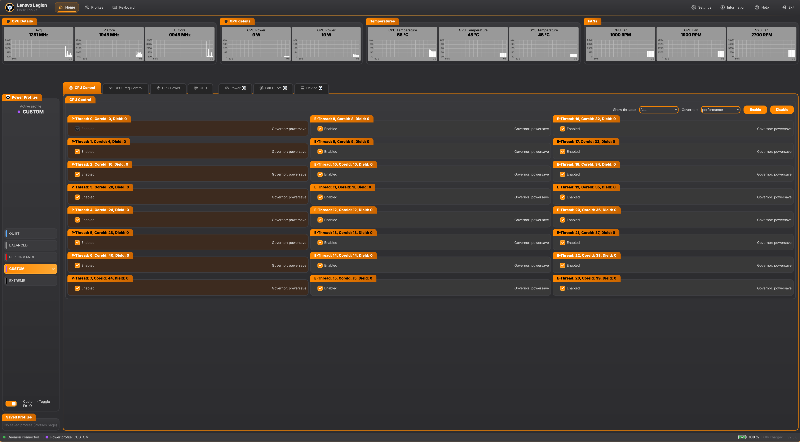
</p>

## Contents

- [Features](#features)
- [Screenshots](#screenshots)
- [How it works](#how-it-works)
- [Supported notebooks](#supported-notebooks)
- [Requirements](#requirements)
- [Installation](#installation)
- [Usage](#usage)
- [Troubleshooting](#troubleshooting)
- [Uninstallation](#uninstallation)
- [Credits](#credits)

## Features

**Power and thermals**
- Power profiles Quiet, Balanced, Performance, Extreme and Custom, switched in the application or by Fn+Q.
- CPU power limits (short term, long term, peak, cross loading, PL1 tau, temperature) and GPU power limits
  (configurable TGP, power boost, temperature, GPU to CPU dynamic boost) in the Custom profile.
- The CPU power limits of the active profile are applied to the kernel powercap (RAPL), also after Fn+Q.
- `platform_profile` support, so other tools (e.g. power-profiles-daemon) see the power profile as well.

**Fans**
- Custom fan curve with 10 points, editable in the Custom profile.
- Fan full speed (Maximum).

**CPU**
- Enable / disable threads, SMT, CPU governor per thread.
- Minimal and maximal frequency per thread, Intel P-State (status, min / max performance, HWP dynamic boost, turbo).
- Intel CPU voltage offsets (undervolt) of the CPU, cache, GPU, uncore and analog I/O planes – any notebook with an
  Intel CPU with the OC mailbox, when undervolting is not locked in the BIOS.

**GPU (NVIDIA)**
- Live clocks, load, VRAM, temperature, power and PCIe link (NVML).
- GPU and memory clock offsets.
- GPU mode: Hybrid, Hybrid (Auto), iGPU only, dGPU only (G-Sync), applied after a restart.

**RGB keyboard**
- Brightness, device profiles and the logo LED.
- Effects with colors and speed per LED, per key group or for the whole keyboard, drawn on a picture of the notebook
  (keyboard, front and rear light bar).

**Monitoring**
- Live charts of the CPU and GPU temperatures, fan speeds, CPU power and frequencies with warning and critical
  thresholds.
- CPU Details and GPU Details windows with live tiles and charts.
- Battery state, health, power and cycles.

**Other**
- Disable the touchpad and the Windows key.
- Profiles: save the whole configuration under a name and load it later.
- The settings are restored by the daemon after a reboot (can be switched off in Settings).
- Themes, tray icon, system check on the Help page.
- Command line tool `lenovo-legion-cli`.

## Screenshots

> The screenshots are in [`docs/screenshots`](docs/screenshots).

| | |
|:---:|:---:|
| <br>**Home** – HW monitor, power profiles, tabs | 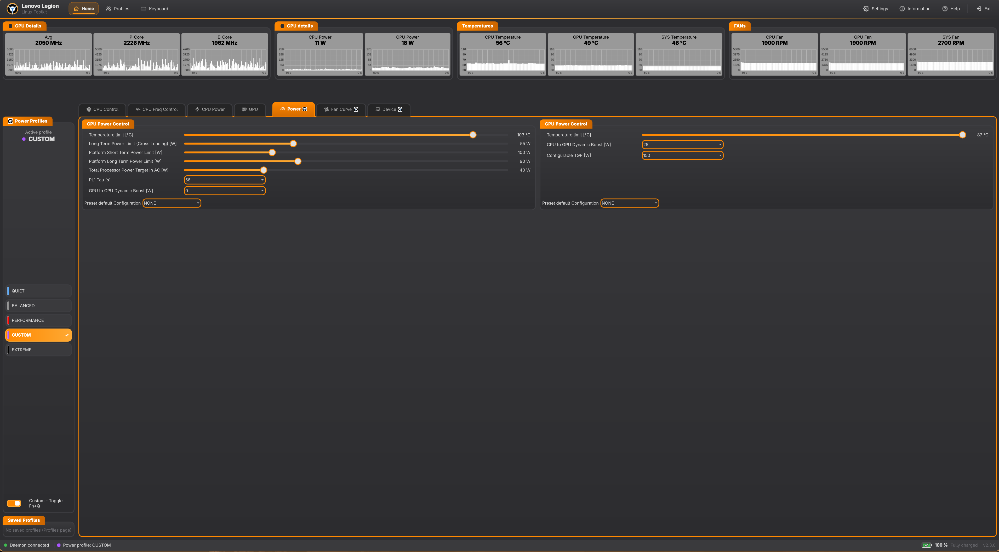<br>**Power** – power limits, GPU, voltage offsets |
| 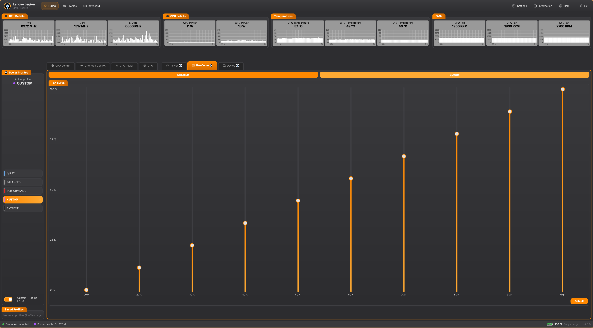<br>**Fan curve** | 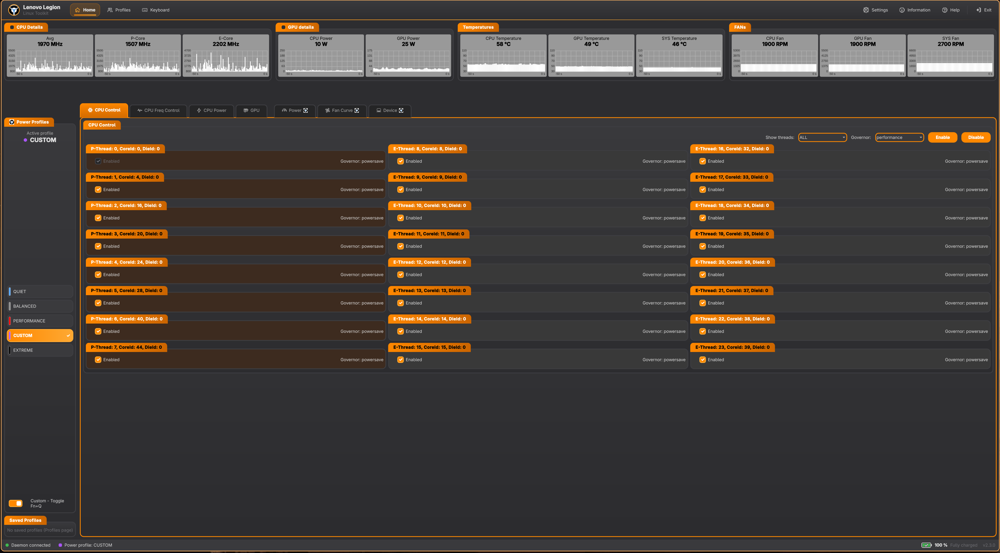<br>**CPU control** – threads, SMT, governors |
| 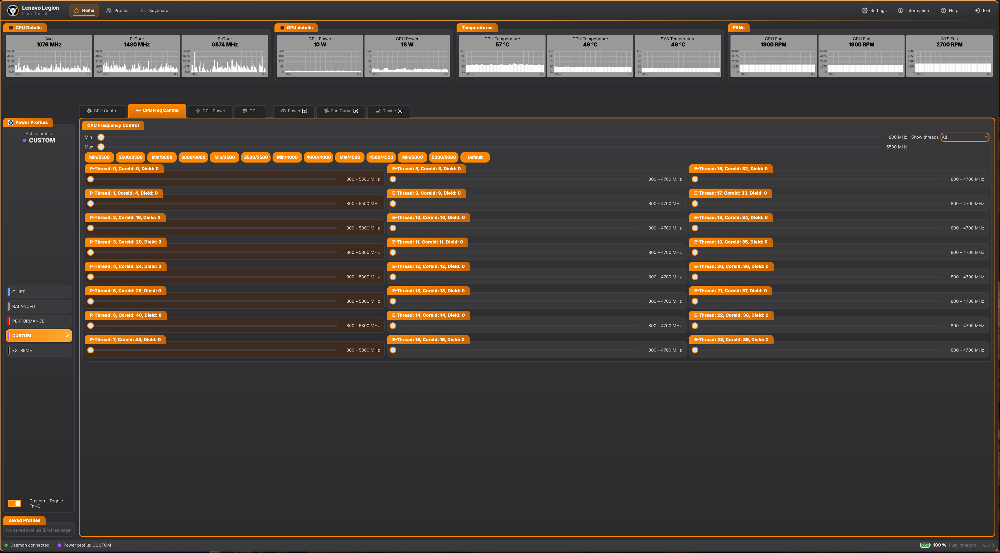<br>**CPU frequency** – per thread limits | 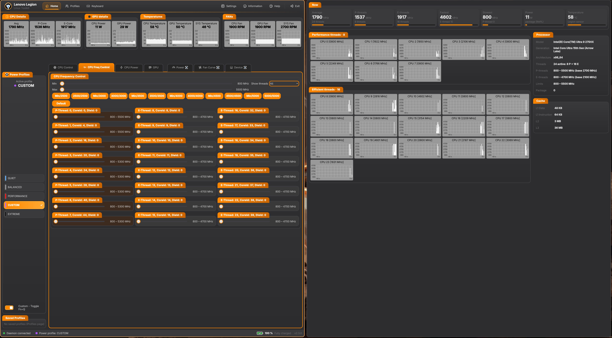<br>**CPU details** |
| 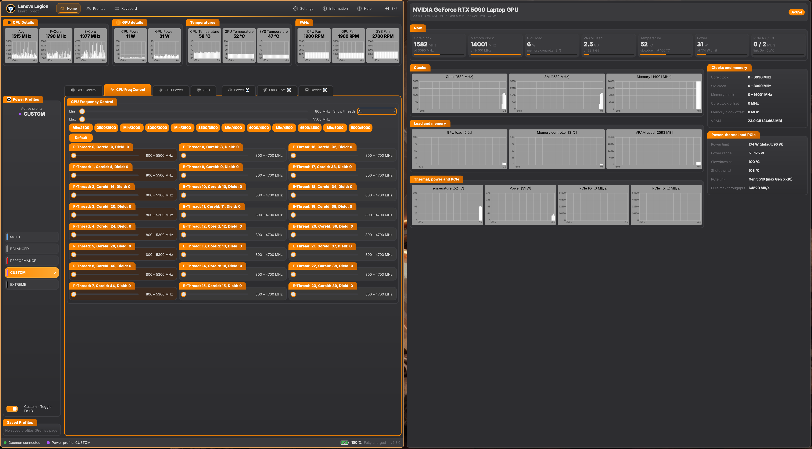<br>**GPU details** | 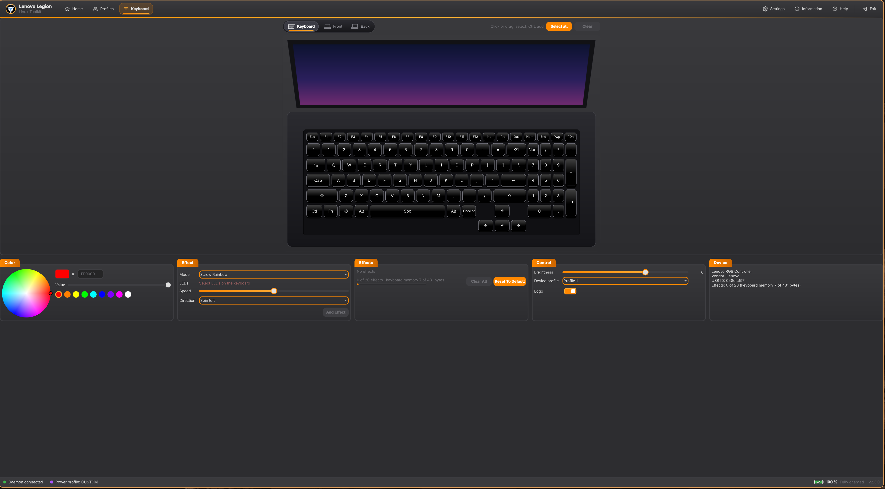<br>**RGB keyboard** – effects and LEDs |
| 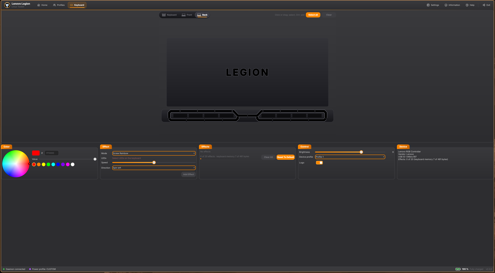<br>**RGB keyboard** – rear light bar | 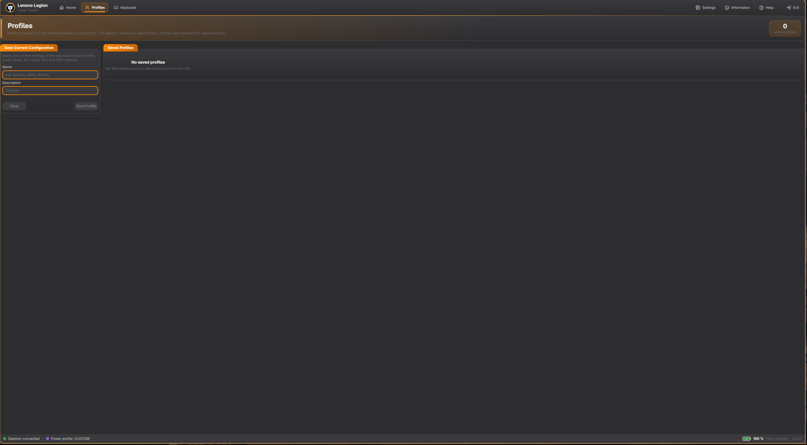<br>**Profiles** |
| 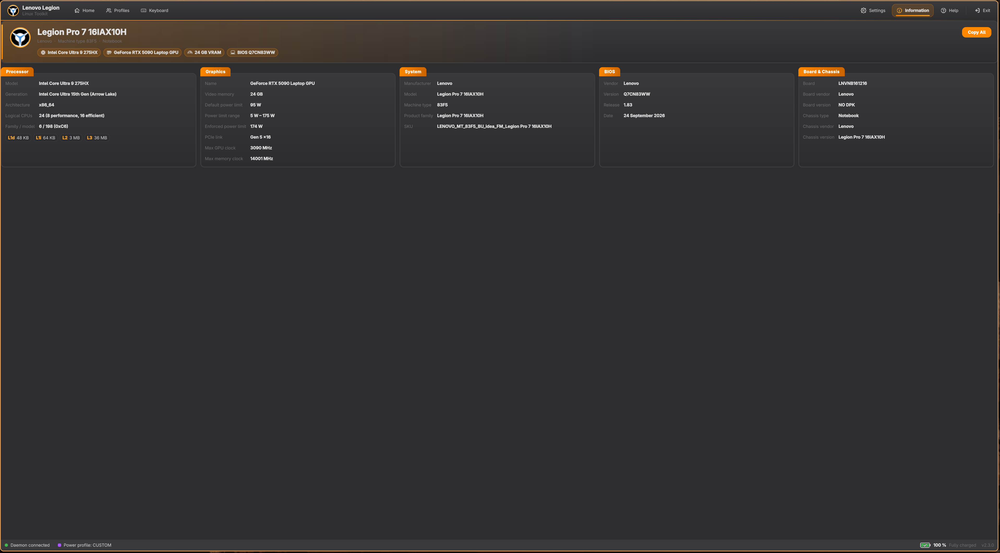<br>**Information** | 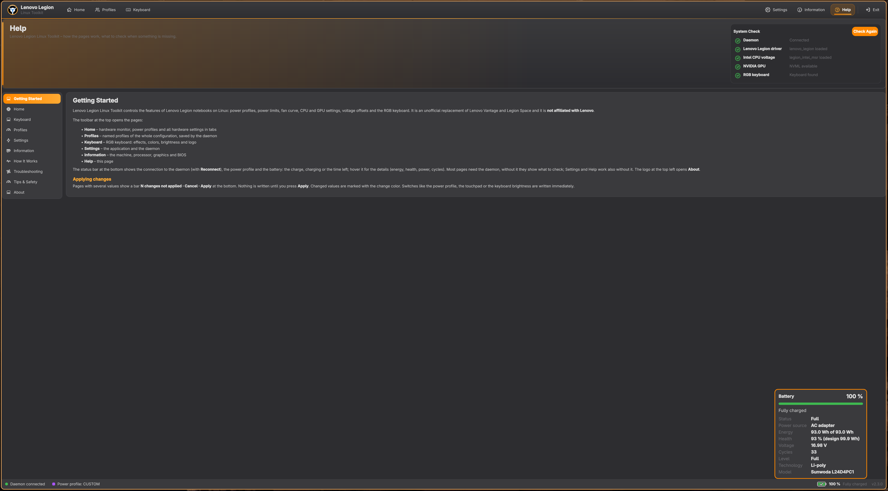<br>**Help** – system check |

## How it works

```
 ┌───────────────────────┐   ┌─────────────────────┐
 │ LenovoLegion (GUI)    │   │ lenovo-legion-cli   │
 │ Qt Quick, any user of │   │ (sysfs directly)    │
 │ the group "legion"    │   └──────────┬──────────┘
 └──────────┬────────────┘              │
            │ local socket /run/lenovo-legion/
 ┌──────────▼───────────────────────────┼──────────┐
 │ LenovoLegion-Daemon (root, systemd)  │          │
 │ framework + modules/*.so (19 modules)│          │
 └──────────┬───────────────────────────┼──────────┘
            │ sysfs, hwmon, powercap, NVML, HID
 ┌──────────▼───────────────────────────▼──────────┐
 │ kernel modules lenovo_legion, legion_intel_msr  │
 │ + standard kernel interfaces (cpufreq,          │
 │   intel_pstate, powercap, power_supply, DMI)    │
 └─────────────────────────────────────────────────┘
```

| Part | Description |
|---|---|
| `lenovo_legion` (kernel module, DKMS) | WMI drivers of the Legion firmware: game zone (power profile, touchpad, Win key, GPU mode), other mode (power limits, fan full speed), fan curve, firmware events, hwmon `legion` (temperatures and fan speeds), `platform_profile`. Loaded automatically on a supported notebook. |
| `legion_intel_msr` (kernel module, DKMS) | Intel CPU voltage offsets through the OC mailbox (MSR 0x150), `/sys/class/legion-intel-msr/intel-msr-0`. Independent of the notebook. |
| `LenovoLegion-Daemon` | Root service. Reads and writes the hardware, checks the values, restores the settings after a reboot, stores the profiles. Every feature is a module in `/opt/LenovoLegion/modules`; a failing module does not stop the others. |
| `LenovoLegion` | The GUI. It runs as a normal user of the group `legion` and talks to the daemon only. |
| `lenovo-legion-cli` | Command line tool for scripts. |

Features that need the Lenovo kernel module are grayed out with the reason when it is not loaded. The generic ones
(CPU, frequencies, NVIDIA GPU, battery, information) work on any notebook.

## Supported notebooks

Tested:
- Legion Pro 7 16IRX9H (Gen 9)
- Legion Pro 7 16IAX10H (Gen 10)

The kernel module is loaded on the Legion models of its DMI table (the product family contains e.g. `16IRX9`,
`16IAX10`, `16ARX8`, `17ACH`, …, see `legion_models` in
[`LenovoLegion-dkms/legion-dkms.c`](LenovoLegion-dkms/legion-dkms.c)). On other notebooks it is not loaded (no error)
and only the generic features are available. The features are enabled by what the firmware reports, so a model that
loads the module but does not support a feature simply does not show it.

Did it work on your notebook? Please open an issue with the output of
`cat /sys/class/dmi/id/product_family /sys/class/dmi/id/product_name` so that the model can be added to the list.

## Requirements

- **Linux kernel 6.12 or newer** with its headers (`linux-headers` or the headers package of your kernel). The kernel
  modules are not built for older kernels.
- systemd.
- Build dependencies:

| Arch package | Purpose |
|---|---|
| `dkms`, `make`, `gcc`, `pkgconf` | kernel modules, build |
| `qt6-base`, `qt6-declarative`, `qt6-5compat` | daemon and GUI (Qt 6) |
| `protobuf` | protocol between the GUI and the daemon |
| `hidapi`, `systemd-libs` (libudev) | RGB keyboard, kernel events |
| `cuda`, `nvidia-utils` | NVIDIA GPU module (NVML) |
| `rust` | `lenovo-legion-cli` |

On other distributions install the packages with the same purpose (e.g. `qt6-base-dev`, `qt6-declarative-dev`,
`libprotobuf-dev`, `protobuf-compiler`, `libhidapi-dev`, `libudev-dev`).

## Installation

### Arch Linux, Manjaro, EndeavourOS

The latest release from the AUR
([`lenovo-legion-linux-toolkit-release`](https://aur.archlinux.org/packages/lenovo-legion-linux-toolkit-release)):

```bash
yay -S lenovo-legion-linux-toolkit-release
```

Or the current development state of the repository
([`LenovoLegion-archpkg/PKGBUILD`](LenovoLegion-archpkg/PKGBUILD), package `lenovo-legion-linux-toolkit`):

```bash
git clone https://github.com/bolekjar/lenovo-legion-linux-toolkit.git
cd lenovo-legion-linux-toolkit/LenovoLegion-archpkg
makepkg -si
```

Install only one of them. The package installs the application to `/opt/LenovoLegion`, the kernel modules by DKMS, the systemd service and adds
the installing user to the group `legion`. Then:

```bash
sudo systemctl enable --now lenovo-legion-daemon.service
reboot      # loads the kernel modules, applies the blacklist and the new group
```

### Other distributions (from source)

Run the commands from the root of the repository.

1. **Kernel modules** (DKMS, rebuilt automatically for new kernels):

   ```bash
   cd LenovoLegion-dkms
   make                 # only build, the results are lenovo_legion.ko and legion_intel_msr.ko
   sudo make dkms       # build and install by DKMS
   # or: sudo make install   (only for the running kernel)
   cd ..
   ```

2. **Daemon, modules and GUI:**

   ```bash
   cd LenovoLegion
   qmake6 && make -j$(nproc)     # result in LenovoLegion/Installation
   cd ..
   ```

3. **Installation of the files:**

   ```bash
   sudo cp -r LenovoLegion/Installation /opt/LenovoLegion
   sudo chmod 755 /opt/LenovoLegion/modules && sudo chmod 644 /opt/LenovoLegion/modules/*.so

   # systemd service, group "legion", directories log/ data/ modules/
   sudo cp LenovoLegion/LenovoLegion-Daemon/lenovo-legion-daemon.service /usr/lib/systemd/system/
   sudo cp LenovoLegion/LenovoLegion-Daemon/lenovo-legion.sysusers /usr/lib/sysusers.d/lenovo-legion.conf
   printf 'd /opt/LenovoLegion/log  2770 root legion -\nd /opt/LenovoLegion/data 2770 root legion -\nd /opt/LenovoLegion/modules 0755 root root -\n' \
       | sudo tee /usr/lib/tmpfiles.d/lenovo-legion.conf
   sudo systemd-sysusers && sudo systemd-tmpfiles --create

   # kernel module configuration
   sudo cp LenovoLegion-dkms/blacklist-lenovo-legion.conf /etc/modprobe.d/
   sudo cp LenovoLegion-dkms/lenovo-legion.conf /etc/modules-load.d/
   sudo cp LenovoLegion-dkms/99-rapl-readonly.rules /etc/udev/rules.d/
   sudo install -m 755 LenovoLegion-dkms/rapl-readonly.sh /opt/LenovoLegion/

   # application menu entry
   sudo cp LenovoLegion/LenovoLegion-Application/LenovoLegion.desktop /usr/share/applications/

   # optional: command line tool
   cargo build --release --manifest-path lenovo-legion-cli/Cargo.toml
   sudo cp lenovo-legion-cli/target/release/lenovo-legion-cli /opt/LenovoLegion/
   ```

4. **Your user in the group `legion`** (the GUI may talk to the daemon):

   ```bash
   sudo install -m 755 LenovoLegion/LenovoLegion-Daemon/lenovo-legion-setup.sh /opt/LenovoLegion/
   sudo /opt/LenovoLegion/lenovo-legion-setup.sh
   ```

5. **Start:**

   ```bash
   sudo systemctl enable --now lenovo-legion-daemon.service
   reboot
   ```

### What the installation changes in the system

- `/etc/modprobe.d/blacklist-lenovo-legion.conf` blacklists `ideapad_laptop` and the kernel `lenovo_wmi_*` drivers.
  Only one driver can bind a WMI device and these drivers use the same firmware interfaces as `lenovo_legion`.
  Features of `ideapad_laptop` (e.g. battery conservation mode) are therefore not available.
- `/etc/modules-load.d/lenovo-legion.conf` loads `legion_intel_msr` and the Intel power and thermal drivers at boot.
- `/etc/udev/rules.d/99-rapl-readonly.rules` makes the RAPL powercap files readable only by root and the group
  `legion` (`energy_uj`, CVE-2020-8694) and the power limits read-only for other tools; the daemon writes them.

## Usage

Start **Lenovo Legion** from the application menu or run `/opt/LenovoLegion/LenovoLegion`.

- **Home** – live HW monitor and power profiles on the top, below the tabs CPU Control, CPU Freq Control, CPU Power,
  GPU, Power, Fan Curve and Device. Tabs grayed out with a reason in the tool tip need a driver that is not loaded.
  Check the box in the title of a chart group to open the CPU Details / GPU Details window.
- **Changes** are applied by Apply in the bar at the bottom of the page (or Cancel). Switches are applied at once.
- **Power limits and the fan curve** can be changed only in the **Custom** profile. In the other profiles their values
  of the profile are shown.
- **Keyboard** – click a key or a light bar to select its LED (Ctrl+click adds, dragging selects a rectangle),
  choose an effect and colors and press Add Effect.
- **Profiles** – save the current configuration and load it later.
- **Settings** – theme, application settings, daemon settings (apply the settings on start, save them on exit,
  logging) and Save Current Configuration.
- **Help** – system check of the daemon, the kernel modules, NVML and the RGB keyboard with hints how to fix them.

The window can be closed to the tray, the daemon keeps the settings applied also without the GUI.

### Command line

```bash
/opt/LenovoLegion/lenovo-legion-cli --help
/opt/LenovoLegion/lenovo-legion-cli --mode                    # current power profile
sudo /opt/LenovoLegion/lenovo-legion-cli --smart-fan-set Quiet
/opt/LenovoLegion/lenovo-legion-cli pwr-get --all             # CPU and GPU power limits
/opt/LenovoLegion/lenovo-legion-cli cpu-get --topology --smt
sudo /opt/LenovoLegion/lenovo-legion-cli off-set-set --cpu -50000   # CPU voltage offset in uV
```

## Troubleshooting

Start with the **Help** page of the application, it checks all parts and tells what is missing.

**The GUI shows "Not connected"**
```bash
systemctl status lenovo-legion-daemon.service
journalctl -u lenovo-legion-daemon.service -b
groups          # must contain "legion", log in again after the installation
```
The log of the daemon is in `/opt/LenovoLegion/log`.

**Lenovo features are grayed out ("Requires the Lenovo Legion kernel driver")**
```bash
lsmod | grep lenovo_legion
modinfo -F version lenovo_legion     # the same version as the application (old module after an update: reboot)
dkms status
# the WMI drivers of lenovo_legion are bound:
for d in /sys/bus/wmi/devices/*; do echo "$(basename $d) -> $(basename "$(readlink $d/driver)")"; done | grep legion
grep -l '^legion$' /sys/class/hwmon/hwmon*/name
```
- Not loaded on your model: the model is not in the DMI table (see [Supported notebooks](#supported-notebooks)).
- Not built: check the kernel version (`uname -r`, 6.12+) and that the headers of the running kernel are installed.
- Secure Boot: the DKMS modules must be signed by a key enrolled with `mokutil`, or Secure Boot disabled.
- `ideapad_laptop` or `lenovo_wmi_*` loaded: the blacklist is missing, reboot after the installation.

**Voltage offsets cannot be applied**
The firmware accepts the write but ignores it when undervolting is locked in the BIOS (common on newer notebooks,
"undervolt protection"). The application shows an error and `dmesg` contains
`legion-intel-msr: offset … was not applied`.

**NVIDIA GPU values are missing**
The NVIDIA proprietary driver with NVML (`nvidia-utils`) is needed. A suspended GPU (hybrid mode, idle) is not
queried, its values appear when it wakes up.

## Uninstallation

```bash
# Arch
sudo pacman -R lenovo-legion-linux-toolkit-release     # or lenovo-legion-linux-toolkit (development package)

# from source
sudo systemctl disable --now lenovo-legion-daemon.service
sudo make -C LenovoLegion-dkms uninstall-dkms      # or: sudo make -C LenovoLegion-dkms uninstall
sudo rm -r /opt/LenovoLegion /usr/lib/systemd/system/lenovo-legion-daemon.service \
    /usr/lib/sysusers.d/lenovo-legion.conf /usr/lib/tmpfiles.d/lenovo-legion.conf \
    /etc/modprobe.d/blacklist-lenovo-legion.conf /etc/modules-load.d/lenovo-legion.conf \
    /etc/udev/rules.d/99-rapl-readonly.rules /usr/share/applications/LenovoLegion.desktop
```

## Credits

- The WMI game zone, events, helpers, other mode and capability data drivers of `lenovo_legion` are based on the
  Lenovo WMI drivers of the Linux kernel by Derek J. Clark.
- Author: Jaroslav Bolek.

Bug reports and pull requests are welcome in the
[issues](https://github.com/bolekjar/lenovo-legion-linux-toolkit/issues).
